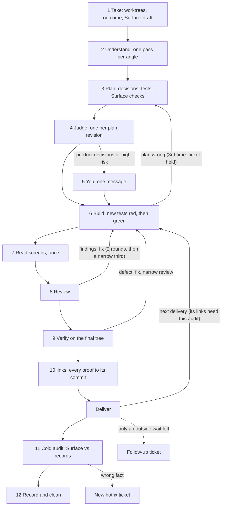

# agentic-workflow

You give it a ticket, or a group of tickets, and they get delivered. You see the plan. You get one message per ticket: the product decisions, each with its options and a recommendation, and, for a high-risk change, the outcome and the facts people act on that it shows or writes, to approve.

The plugin is four skills (deliver, onboard, test, design), the files they read, and six small Node scripts with no dependencies. Agents do the work and judge its meaning; fresh agents check it against raw sources (code, git, logs, data, the running app). The scripts count, match and compare: they check that a plan's citations resolve, count review rounds, record test runs, run each ticket's allow-listed checks (one run at a time per ticket, which only that ticket stops or partly reruns) and confirm every link before delivery. None of them decides what the work is, and no hook enforces anything. It works in Claude Code and in Codex.

## How it works

Each ticket starts from its outcome: what is true for its users once it is delivered, and the most direct evidence of it. The orchestrator tracks how far the work is from that outcome and picks each next move by what shortens the distance; its type (hotfix, bug, enhancement, new feature) and size set how many agents work on it, and the outcome how deep each step goes; every plan is judged, and every change reviewed and verified:

1. take the ticket: a folder, fresh worktrees, and a first list of the facts its users act on that it shows or writes, such as amounts, appointment times or who may do what (its Surface);
2. understand it, one pass per angle;
3. plan it short: decisions with sources, a test table, the Surface with a runnable check per line;
4. one fresh judge per plan revision answers eight questions; a second judge comes only after a builder finds the plan wrong;
5. one message to you: product decisions, and approval of a high-risk outcome and Surface;
6. build, each new test shown red on the base where it should fail, and green after;
7. for a screen, one fresh reader who has only the screenshots and their purpose;
8. review against eight questions, at most two rounds, then one narrow third only for a Surface fix or a change made after review;
9. verify in the target environment;
10. deliver, once a script confirms every link from proof to commit; a remaining delivery that can only wait on an outside party or elapsed time becomes a follow-up ticket once the rest is delivered;
11. after each delivery, a cold audit compares every fact on the Surface with its record;
12. record and clean up.

Every loop has a limit. A third "plan wrong" holds the ticket; a finding on the outcome or the Surface still open after the narrow third review holds the delivery; either way you get the evidence. Findings outside the outcome left after round 2 go into the handoff. Nothing on the Surface or in the outcome is dropped to get it through.



The full method is [`skills/deliver/WORKFLOW.md`](skills/deliver/WORKFLOW.md). It takes about fifteen minutes to read.

## Install

Claude Code:

```bash
claude plugin marketplace add o-m-a-r-k/agentic-workflow
claude plugin install agentic-workflow@agentic-workflow
```

Codex:

```bash
codex plugin marketplace add o-m-a-r-k/agentic-workflow
codex plugin add agentic-workflow@agentic-workflow
```

Claude Code sets each worker's effort from version 2.1.292, and reads `AGENTS.md` without a `CLAUDE.md` from 2.1.277. Earlier versions still work; workers then run at the session's effort. The scripts need Node.js 20 or later on the machine the agents run on.

## Use

Four skills: `deliver`, `onboard`, `test`, which planning, building and review follow so every test earns its place, and `design`, which they follow for anything people see.

1. **Onboard a project once:** ask for the `onboard` skill. An agent describes how your project delivers, from its repos, CI and your words, then proves the description by walking a practice ticket through every safe step, and shows you what it found, what it proved and what proving a change costs. Run it again at any time. It writes only what you confirm.
2. **Deliver:** ask for the `deliver` skill with one or more tickets and their type, for example "deliver EX-41 and EX-42, both bugs".

## Where things live

| What | Where |
|---|---|
| The project's rules | each repo's `AGENTS.md` |
| The project definition | `.agents/project.md` in the folder that holds the project's repos, when that folder is versioned (found from the current directory upward, or in a sibling folder); otherwise `~/.agents/projects/<project>.md`; machine-only facts in `~/.agents/projects/<project>.local.md` |
| A ticket's state | `<work>/<ticket>/`, where `work` is set in the project definition: `PLAN.md`, `CHECKS.json`, `STATE.md`, `evidence/` and the worktrees. It is never committed; inside a repo, it is excluded through `.git/info/exclude`. |
| Your settings | `~/.agents/workflow.yaml`: role models over [`defaults.yaml`](skills/deliver/defaults.yaml), how many agents and heavy runs at once, context size, and named profiles such as one for a local model (see the deliver skill's Settings) |
| Finished tickets | `~/.agents/records.jsonl`, one line each, written by the `record` script, where `~/.agents` already exists |
| The scripts | `skills/deliver/scripts/`, run as `node <skill folder>/scripts/<name>.mjs`; tests in `test/`, run with `node --test test/*.test.mjs` |

## Coming from 0.x

0.9.0 replaces 0.8 and earlier entirely. There is no `wf` command, no hooks, and no adapter. Remove the old `wf` link from your PATH, the `wf-*` agent definitions 0.x generated in each project, and the parts of each `AGENTS.md` that describe the `wf` workflow. Then run `onboard` for each project. The earlier code remains in the git history and its tags.

## License

[MIT](LICENSE)
