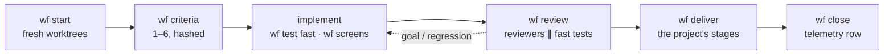

# agentic-workflow

**One flow per ticket for coding agents: fresh worktrees, independent reviewers that read the whole change, and your own delivery.**

[](CHANGELOG.md)
[](https://github.com/o-m-a-r-k/agentic-workflow/actions/workflows/ci.yml)
[](LICENSE)

agentic-workflow runs software changes with Claude Code and Codex. Each ticket gets its own git worktrees from a fresh base, one to six plain criteria, an implementer, and reviewers that `wf` launches itself, so it knows they did not write the change and can check from their transcripts that they read every changed file. Delivery follows the project's own stages: a push to main, a merge request per repo, a tracker status, a deploy confirmation. A hash-chained ledger records each step, and each closed ticket writes a telemetry row that every later change to the workflow is measured against.

> **Status: v0.8, early.** 0.8 is a smaller core, rebuilt from measurements of fifty real tickets ([what changed and why](docs/releases/v0.8.0.md)). It is covered by scenario tests on real git repositories, run on macOS and Linux in CI. Expect rough edges and breaking changes before 1.0. [Changelog](CHANGELOG.md) · [design](docs/design-0.8.md).

## What it checks

| Failure | What `wf` refuses |
| --- | --- |
| A review that sampled the change | Recording a review while a product file in the diff is missing from the reviewer's transcript (`review:coverage`) |
| The author reviews its own change | A review from a session that implemented, or that `wf` did not launch (`review:independent`) |
| A review of an older tree | A review whose tree is not HEAD (`review:tree`); a merge with anything but git's automatic base merge changed since the reviewed tree (`merge:unreviewed`) |
| A repair that broke something | `other` on a line this attempt wrote (`finding:other-own`); merging with a `goal` or `regression` finding open, at any severity (`merge:open`) |
| A test that asserts nothing on a risky change | On a risk path: a merge without a test that fails on the merge-base, a second reviewer on another model and the person's diff-read (`merge:risk`) |
| Cropped or stuck screenshots | A capture narrower than its viewport (`screens:width`), or the same bytes as another screen (`screens:dup`) |
| Pushing to main with no CI run | A landed tree without a passing `full` run (`merge:untested`) |
| An agent answering for the person | An answer that is not the person's own turn, right after the question (`answer:not-person`) |
| Fix rounds that go nowhere | Another fix round after a review that reopened a fixed finding or did not lower the blocker count, until the person decides (`fix:no-progress`) |

Nineteen refusals in all, each a fact check with a named failure ([the list](docs/design-0.8.md#refusals-each-a-fact-check)).

## Install

Requires Node.js 20+ and git, on macOS or Linux; Windows is not supported.

```bash
claude plugin marketplace add o-m-a-r-k/agentic-workflow
claude plugin install agentic-workflow@agentic-workflow
# put wf on your PATH, once (the plugin is cached under a versioned folder)
node "$(ls -d ~/.claude/plugins/cache/agentic-workflow/agentic-workflow/*/ | tail -1)scripts/install.mjs"
```

For Codex, or without a plugin system: clone this repository and run `node scripts/install.mjs` in it.

## Onboard a project

```bash
cd my-project
wf init                 # scans the repos and proposes the adapter, key by key, with reasons; writes nothing
wf init --confirm all   # writes what you confirm (or confirm keys one by one); re-run any time to re-evaluate
wf doctor
```

Or ask your agent to "onboard this project to agentic-workflow". The scan proposes the risk paths, the `fast`/`full` test split, the screens settings, the ticketing and the delivery stages; you confirm or edit each. The adapter lives in `.workflow/project.yaml` in a repo, or in `~/.agentic-workflow/projects/<name>.yaml`, so nothing has to be committed in the product repos. [Onboarding](docs/onboarding.md) · [adapter](docs/adapter.md).

Coming from 0.7: `wf init --from-07`, then `wf migrate attempts` ([migration](docs/releases/v0.8.0.md#migrating-from-07)).

## How it works



1. **Start:** `wf start <item>` normalises the ticket id, fetches, and makes one worktree per repo at the tip of its base.
2. **Criteria:** a planner (or the owner, for a small fix) writes 1 to 6 checkable criteria; edits are recorded with their hash.
3. **Implement:** the implementer runs `wf test fast` and `wf screens` (the screens the change reaches, plus a sentinel set when shared code changed), then commits.
4. **Review:** `wf review` launches fresh reviewers with a bundle as their whole prompt (the diff, the criteria, the invariants, the rules for the touched paths, the consumers of changed contracts, the screenshots) while the fast tests run on the same tree. A risk change adds a second reviewer on another model and the risk checklist.
5. **Fix rounds** run only for open `goal` or `regression` findings. `other` findings are filed in the tracker, put in the person's daily digest, or listed, as the project chooses.
6. **Deliver:** `wf deliver` runs the stages the attempt started with: landing (directly, or through the landing queue for projects without CI), pushes, merge requests per repo matched by patch-id, statuses and comments with markers, a deployment confirmation.
7. **Close:** `wf close` writes the telemetry row, removes the worktrees and keeps the branches.

`wf status` names one next command per attempt. The person's decisions (a deploy, a waiver, a loosened criterion, the risk diff-read, a foreign merge, the no-progress stop) are asked once, in plain words, and collected in `wf digest`.

## Trust model, in short

- **Checked:** the ledger's hash chain, the tree each test run and review was on, the reviewer's independence and coverage from the host's transcripts, the merge facts, the tracker's readback, the person's answers from their own turns.
- **Not stopped:** a process running as your user that sets out to rewrite everything consistently. wf catches mistakes, not attacks ([D6](docs/DESIGN.md#decisions-that-survive)).

## When not to use it

- Windows, or work outside git.
- Throwaway scripts where a review costs more than a mistake.
- A hard security boundary against a hostile agent.
- A hosted dashboard: wf is a local CLI and files.

## Docs

| Page | What is in it |
| --- | --- |
| [Concepts](docs/concepts.md) | Terms, how the parts fit, principles |
| [Adapter](docs/adapter.md) | The schema 2 adapter, with two full examples |
| [Onboarding and secrets](docs/onboarding.md) | `wf init`, re-running it, `wf doctor`, secrets |
| [Delivery and tracker](docs/delivery-and-tracker.md) | Stages, the landing queue, ticketing through a connector, a module or files |
| [Telemetry and learning](docs/telemetry.md) | The per-ticket row, `wf report`, proposals and the budget |
| [Local state](docs/state-folders.md) | The state folders and cloud sync |
| [Scenarios](docs/SCENARIOS.md) | Every behaviour scenario |
| [Design register](docs/DESIGN.md) | The decisions and why; [the 0.8 design](docs/design-0.8.md) |

## Contributing, security, license

Contributions are welcome: see [CONTRIBUTING.md](CONTRIBUTING.md) (every fix names its failure and ships a scenario test). Report security issues privately as described in [SECURITY.md](SECURITY.md). [MIT](LICENSE).
