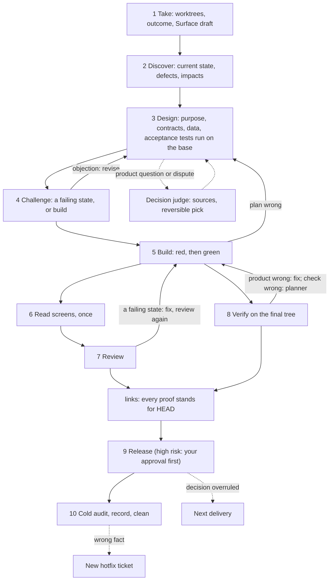

# agentic-workflow

You give it a ticket, or a group of tickets, and they get delivered. Nothing waits on you: product decisions are decided by a fresh agent from established practice (vendors' documentation, standards, law, published research), with their sources, and listed in the handoff for you to overrule. The only thing you are asked, in one plain message, is approval of a change the project can't undo, and that holds only the irreversible delivery step.

The plugin is four skills (deliver, onboard, test, design), the files they read, and six small Node scripts with no dependencies that share one reader of a ticket's files. Agents do the work and judge its meaning; fresh agents check it against raw sources (code, git, logs, data, the running app). The scripts count, match and compare: they check that a plan can be read by every later script and that its citations resolve, count review rounds, record test runs, run each ticket's allow-listed checks without rerunning what still stands (a merge or base move that leaves the change's files alone proves nothing again), and confirm every link before delivery. None of them decides what the work is, and no hook enforces anything. It works in Claude Code and in Codex.

## How it works

Each ticket starts from its outcome: what is true for its users once it is delivered, and the most direct evidence of it. Defects are found before the build, where they cost minutes: the work discovers the current state of everything the change touches, designs from it, and has the design attacked until nobody can name a state where it fails. Review and verification then find only what the build introduced. The ticket's size (hotfix, small, new feature, big change) sets how deep each step goes, from one table; it never changes when a step is done:

1. take the ticket: a folder, fresh worktrees, and a first list of the facts its users act on that it shows or writes, such as amounts, appointment times or who may do what (its Surface);
2. discover: the current state of everything the change touches, what is already broken there, every impact, and a reproduction for a bug, each finding shown by running something;
3. design: from the outcome and the current state, the screen's purpose (by the `design` skill) and the backend's contracts, data, migrations, state machines and failure paths, with diagrams where there are states; the acceptance tests, each seen failing on the base, and every check run once on the base;
4. challenge: fresh challengers attack the design; each objection names a state where it fails; the designer revises until none can, and a decision judge rules on product questions and disputes, with sources, which the plan records;
5. build, red then green against the acceptance tests;
6. for a screen, one fresh reader who has only the screenshots and their purpose;
7. review, round after round while a reviewer names a state where the change fails, alongside 8. verification in the target environment, its heavy checks once review is clean; anything there before the change is fixed in that round and counted as a Discover miss;
9. release, one delivery unless people are failing now, once a script confirms every link from proof to what is delivered;
10. after each delivery, a cold audit compares every fact on the Surface with its record; then record and clean up.

Nothing on the Surface or in the outcome is dropped to get it through.



The full method is [`skills/deliver/WORKFLOW.md`](skills/deliver/WORKFLOW.md). It takes about fifteen minutes to read.

## Install

Claude Code:

```bash
claude plugin marketplace add o-m-a-r-k/agentic-workflow
claude plugin install agentic-workflow@agentic-workflow
```

Codex:

```bash
codex plugin marketplace add o-m-a-r-k/agentic-workflow
codex plugin add agentic-workflow@agentic-workflow
```

Claude Code sets each worker's effort from version 2.1.292, and reads `AGENTS.md` without a `CLAUDE.md` from 2.1.277. Earlier versions still work; workers then run at the session's effort. The scripts need Node.js 20 or later on the machine the agents run on.

## Use

Four skills: `deliver`, `onboard`, `test`, which design, building and review follow so every test earns its place, and `design`, which they follow for anything people see.

1. **Onboard a project once:** ask for the `onboard` skill. An agent describes how your project delivers, from its repos, CI and your words, then proves the description by walking a practice ticket through every safe step, and shows you what it found, what it proved and what proving a change costs. Run it again at any time. It writes only what you confirm.
2. **Deliver:** ask for the `deliver` skill with one or more tickets and their type, for example "deliver EX-41 and EX-42, both bugs".

## Where things live

| What | Where |
|---|---|
| The project's rules | each repo's `AGENTS.md` |
| The project definition | `.agents/project.md` in the folder that holds the project's repos, when that folder is versioned (found from the current directory upward, or in a sibling folder); otherwise `~/.agents/projects/<project>.md`; machine-only facts in `~/.agents/projects/<project>.local.md` |
| A ticket's state | `<work>/<ticket>/`, where `work` is set in the project definition: `PLAN.md`, `CHECKS.json`, `STATE.md`, `evidence/` and the worktrees. It is never committed; inside a repo, it is excluded through `.git/info/exclude`. |
| Your settings | `~/.agents/workflow.yaml`: role models over [`defaults.yaml`](skills/deliver/defaults.yaml), how many agents and heavy runs at once, context size, and named profiles such as one for a local model (see the deliver skill's Settings) |
| Finished tickets | `~/.agents/records.jsonl`, one line each, written by the `record` script, where `~/.agents` already exists |
| The scripts | `skills/deliver/scripts/`, run as `node <skill folder>/scripts/<name>.mjs`; tests in `test/`, run with `node --test test/*.test.mjs` |

## Coming from 0.x

0.9.0 replaces 0.8 and earlier entirely. There is no `wf` command, no hooks, and no adapter. Remove the old `wf` link from your PATH, the `wf-*` agent definitions 0.x generated in each project, and the parts of each `AGENTS.md` that describe the `wf` workflow. Then run `onboard` for each project. The earlier code remains in the git history and its tags.

## License

[MIT](LICENSE)
