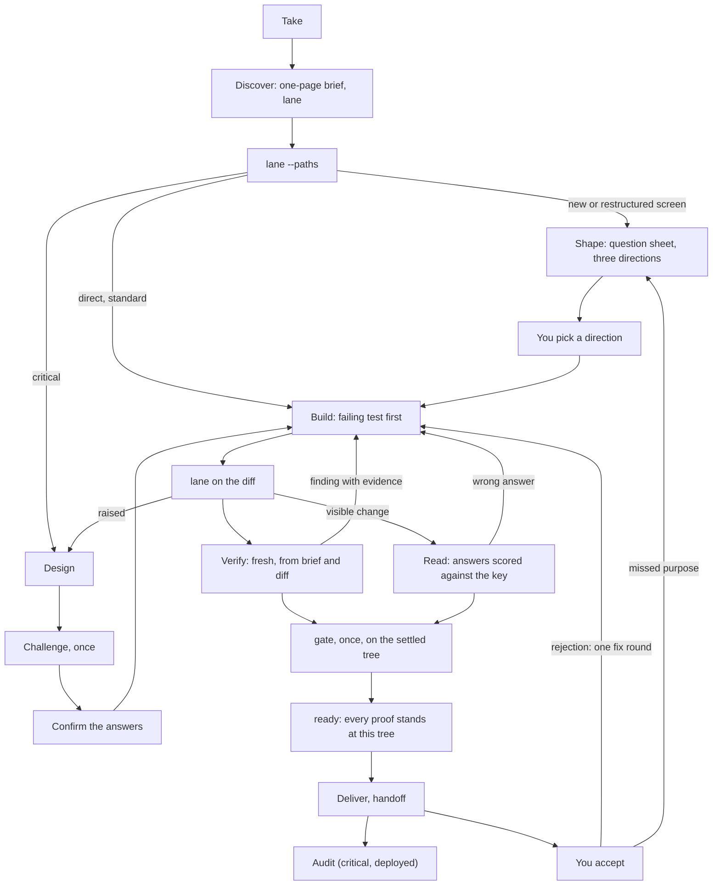

# agentic-workflow

You give it a ticket, or a group of tickets, and they get delivered. How much process a ticket gets is set by what the change can damage, not by its label: a small fix costs two agents and one test run, and only a change that touches money, access, stored data or a contract gets a design and a challenge.

The plugin is five skills (deliver, onboard, design, test, triage), the files they read, and seven small Node scripts with no dependencies. Agents do the work and judge its meaning; fresh agents check it from raw sources. The scripts count, match and compare: they find the lane a change's paths require, run the project's proof once on the settled tree, list tests that were deleted or skipped, confirm before delivery that every proof still stands at the tree being delivered, count the words on a screen, run the project's fact checks, and write each ticket's numbers. No hook enforces anything. It works in Claude Code and in Codex.

## How it works

**Three lanes.** Discover names the lane; a script raises it when the paths touch a boundary the project has mapped; nothing lowers it.

| Lane | When | What it gets |
|---|---|---|
| Direct | Restores or adjusts behaviour that already exists | Discover and build in one worker, a fresh verifier, the gate |
| Standard | New behaviour, no boundary touched | A brief, a build, a fresh verifier, the gate |
| Critical | A boundary or a migration is touched, or it cannot be undone | A short design with one challenge, a verifier per boundary with the project's fact checks, the gate, an audit where it is deployed |

**Screens start from questions.** A new or restructured screen begins with a half-page question sheet (who arrives, what they ask, in what order) and an answer key written from seeded data. Three rough directions are built in the real app and you pick one from screenshots: the one planned wait on you. The built screen is then judged by fresh readers answering the questions from screenshots alone, scored against the key. An answer found only in a sentence counts as not given, so a screen cannot be passed by adding text.

**Loops end by rule.** A finding needs evidence or it is a note. A recheck reads only the fix. When the same finding stays open twice, the choice behind it is wrong and you are asked one question.

**Bugs found on the way** are fixed in the ticket as their own commits. One that touches a boundary or needs a design becomes the next ticket started. The `triage` skill holds the rubric.

**You are asked for** a screen's direction, approval of a step the project cannot undo, and an access a worker could not get. Product questions are answered by a fresh agent from sources and listed in the handoff for you to overrule.



The full method is [`skills/deliver/WORKFLOW.md`](skills/deliver/WORKFLOW.md). It takes about ten minutes to read.

## Install

Claude Code:

```bash
claude plugin marketplace add o-m-a-r-k/agentic-workflow
claude plugin install agentic-workflow@agentic-workflow
```

Codex:

```bash
codex plugin marketplace add o-m-a-r-k/agentic-workflow
codex plugin add agentic-workflow@agentic-workflow
```

Claude Code sets each worker's effort from version 2.1.292, and reads `AGENTS.md` without a `CLAUDE.md` from 2.1.277. Earlier versions still work; workers then run at the session's effort. The scripts need Node.js 20 or later on the machine the agents run on.

## Use

Five skills: `deliver`; `onboard`; `design`, which shaping, building and reading follow for anything people see; `test`, so every test earns its place; and `triage`, which decides what becomes of anything found on the way.

1. **Onboard a project once:** ask for the `onboard` skill. An agent describes how your project delivers, from its repos, CI and your words, then proves the description by walking a practice ticket through every safe step, and shows you what it found, what it proved and what proving a change costs. Run it again at any time. It writes only what you confirm.
2. **Deliver:** ask for the `deliver` skill with one or more tickets and their type, for example "deliver EX-41 and EX-42, both bugs".

## Where things live

| What | Where |
|---|---|
| The project's rules | each repo's `AGENTS.md` |
| The project definition | `.agents/project.md` in the folder that holds the project's repos, when that folder is versioned (found from the current directory upward, or in a sibling folder); otherwise `~/.agents/projects/<project>.md`; machine-only facts in `~/.agents/projects/<project>.local.md` |
| A ticket's state | `<work>/<ticket>/`, where `work` is set in the project definition: `STATE.md`, `BRIEF.md`, on the critical lane `DESIGN.md` and `CHECKS.json`, for a shaped screen `QUESTIONS.md` and `ANSWERS.md`, `evidence/` and the worktrees. It is never committed; inside a repo, it is excluded through `.git/info/exclude`. |
| Your settings | `~/.agents/workflow.yaml`: role models over [`defaults.yaml`](skills/deliver/defaults.yaml), how many agents and heavy runs at once, context size, and named profiles such as one for a local model (see the deliver skill's Settings) |
| Finished tickets | `~/.agents/records.jsonl`, one line each, written by the `record` script, where `~/.agents` already exists |
| The scripts | `skills/deliver/scripts/`, run as `node <skill folder>/scripts/<name>.mjs`; tests in `test/`, run with `node --test test/*.test.mjs` |

## Coming from 0.16

0.17 replaces the method. A ticket already running stays on the version it started with. For new tickets, run `onboard` again for each project: the definition gains `boundaries`, `migrations`, `page_paths` and `gate`, and its Screens section gains the accepted screens, the state axes and how a screen is captured with its visible text. There is no `PLAN.md`, and `plan-shape`, `links` and `rounds` are gone.

## License

[MIT](LICENSE)
