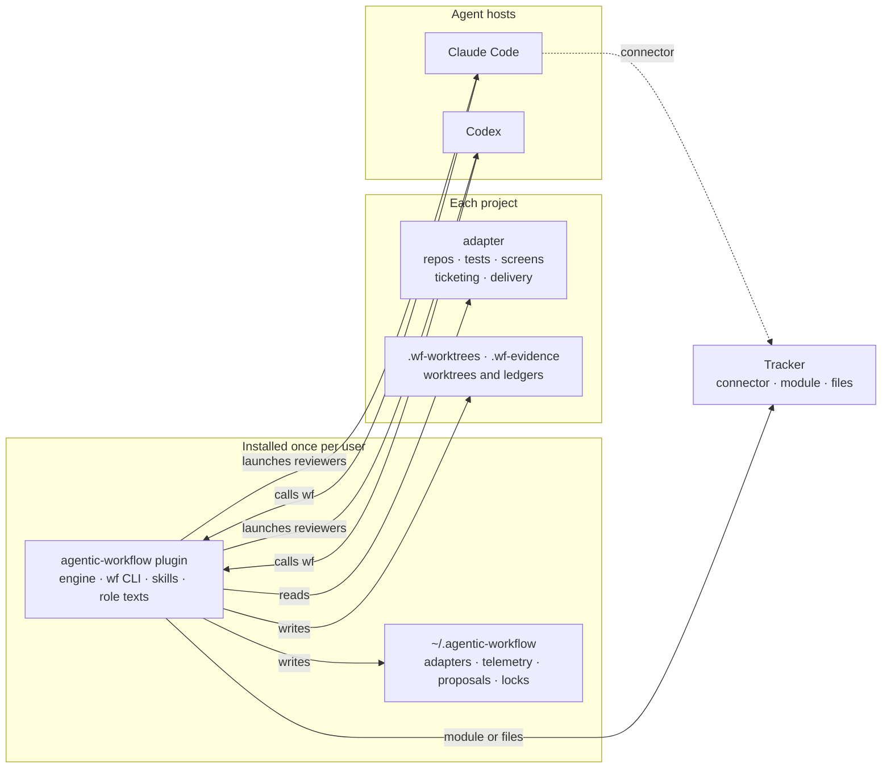

# Concepts: terms, parts and principles

[Back to the README](../README.md) · [Docs map](../README.md#docs)

## Terms

- **Project**: the whole onboarded system: one adapter, one tracker. It may hold several repos.
- **Repo**: one Git repository inside the project.
- **Component**: a logical part of the system that consumes another's contracts (a web app reading an API's routes), named in the adapter so reviewers see the consumers of a changed contract.
- **Attempt**: one try at one ticket, `<item>.<n>`: its worktrees, its branch `wf/<item>.<n>` per repo, and its ledger.
- **Plugin**: agentic-workflow itself.

The word "workspace" is never used for any of these.

## How it fits together

- **Plugin:** the engine and the `wf` CLI. It knows no framework, tracker, language or company.
- **Adapter:** the project's settings, schema 2 ([adapter.md](adapter.md)). It lives in a repo (`.workflow/project.yaml`) or in the user folder; `wf init` writes it.
- **Session rules:** the plugin's SessionStart and SubagentStart hooks give every Claude Code session in a project the workflow's standing rules, filled from its adapter and invariants. Codex plugins carry no hooks, so Codex sessions do not get them. The workflow writes nothing into the project's own instruction files.
- **Hosts:** everything about Claude Code and Codex lives in `engine/hosts/`: how a session is recognised, how a reviewer is launched and resumed, and how its transcript is read.

## Principles

The full list, with the retired ones, is in the [design register](DESIGN.md#principles).

1. Authority to deliver is an attempt with no hold; the person's reserved decisions are answered only by the person's own turn.
2. Facts come from git, the ledger and the host's records, never from an agent's claim.
3. The reviewer never wrote the change, and `wf` launches it.
4. Criteria come first, hashed, not frozen.
5. Every refusal names the failure it catches, and every rule-shaped change is counted against the budget.
6. Agents never handle secret values.
7. The engine stays framework-, tracker- and harness-agnostic. Specifics live in the adapter and in `engine/hosts/`.
