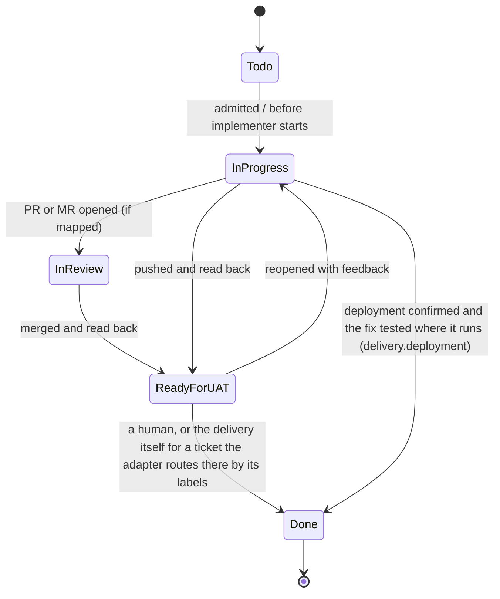

# Delivery and the tracker handoff

[Back to the README](../README.md) · [Docs map](../README.md#docs)



- **Delivery adapters** do the git side, in three parts:
  - `integrate`: push to main, or open a PR/MR. It runs on every `wf deliver` for a repo that is not delivered yet, so it keeps an open request at the worktree's HEAD (or tells the owner where to push it): after a base moved while the request waited and `wf base merge` reconciled the branch, the gate, review and acceptance run again and this call is what updates the request ([Base movement](lifecycle.md#base-movement)).
  - `observe`: report the state: `integrated`, `awaiting-merge` or `ci-running` (`wf deliver` exits 0 and says to run it again once merged), or `rejected` or `ci-failed` (`wf deliver` refuses with the state and what to do). Any other value, a typo or no state at all refuses too, naming what was received and the valid states. When the change is already on the target branch and the adapter reports anything but `integrated` or a pending state, `wf deliver` refuses until the owner acknowledges that repo and state (`--acknowledge-adapter-state <repo>:<state>`); a retry always asks the adapter again. The adapter is read from the commit the attempt was admitted at, so committing a fixed adapter does not reach the running attempt by itself: `wf deliver --repin-adapter --reason "<why>"` shows the owner what changes and, once confirmed with the base tip, re-reads the delivery adapter from the base branch. [Recovering from an adapter fault](lifecycle.md#recovering-from-an-adapter-fault) gives each case and the scenario that proves it.
  - `readback`: prove the change is on the target branch.
  - `deployment` (optional, 0.7.27): for a project whose delivery waits for the deployment (`delivery.deployment`, [below](#the-deployment-confirmation-after-the-merge)), the project's own read-only check that the merged change runs where it deploys.

  `push-main` is built in; anything else is one file in your project.
- **Tracker adapters** map lifecycle events to status changes, comments and attachments. Linear, GitHub Issues and tickets as files in the repo are built in; any other tracker, including your own product's API, is one adapter file (`tracker.kind: ./.workflow/tracker/<name>.mjs`). Its `normalize(raw)` returns the issue the engine reads back as `{ id, title, description, status, labels?, comments: [{ id, body, createdAt, updatedAt }], attachments: [{ id, title, filename, subtitle, url }], updatedAt, url }`; `labels` (0.7.27) is an optional list of the issue's label names, which a project may route a step's status by (`statusByLabel`, below), left out when the readback has none to give. An adapter's `perform` (per route) sets the status each `setStatus` action hands it, as it is, and called with no actions only reads and returns its readback: the engine uses that to read the ticket's labels before setting a status routed by them. Its `isUpload(attachment)` tells an uploaded file from a link, and its optional `screenshots` (`embedded` by default, `attachments` or `attachments-only`) says whether the delivered comment embeds the screenshots or the tracker shows them as attachments (below).

## Delivering to another branch, and to more than one (0.7.30, I-201, D62)

Each repo has one configured base (`repos[].base`), and an attempt is delivered there unless it names another branch:

- **Its own target.** `wf entry --target <repo>=<branch>` (or `--target <branch>` for every repo of the attempt) bases the repo's worktree on that branch, as fetched, and delivers it there: base comparisons, `wf base merge`, `push-main` and a delivery adapter (`ctx.repo.base` is the branch) all use it, and the adapter the attempt follows is the one committed on that branch of the adapter repo (D60). `wf status` shows `delivered to: <repo> -> <branch>`. The same item may be open once per target: a hotfix to `main` and the same fix on `release-2` are two attempts.
- **More targets for one change.** `wf entry --also-target <repo>=<branch>` at admission, or `wf target add <repo>=<branch> --reason "<why>"` later (the reason is recorded; when the person asked for it, their words), names a branch the change also goes to. Once the attempt's own delivery is complete, `wf deliver` admits a **port** for each: an attempt of the same item on that target, with the same owner, that carries the source's own commits (cherry-picked; base merges and merges left out), the criteria its source froze and its impact map. The port is gated, reviewed, accepted and delivered like any attempt, and moves no ticket status (the ticket's status and comments are its source's). `wf entry --port <attempt> --target <repo>=<branch>` admits one by hand, from an accepted or delivered attempt of the same item.
- **A commit that does not apply** to the target is not hidden or guessed at: the cherry-pick is aborted, the port keeps the commits that applied (its worktree clean on the target), and `wf status` names the commit, its subject, the conflicting files and how many are left; an implementer ports them by hand against the frozen criteria, then the review and the gate run as usual. A port whose every commit applied needs no implementer first, as a batch does not.

## Where tasks live and how wf reaches them

Two questions at onboarding: **where do your tasks live** (`tracker.kind`) and **how should wf reach it** (`tracker.via`). With an engine route (`api`, `cli`, `files`) the engine reads the ticket, sets the status, uploads the screenshots after `wf shown`, posts the comment that embeds them and records its own readback through the same checks as an agent capture. With `connector` the agent calls the tracker's tools and saves the readback; it is recorded as "agent-reported, unverified" (shown in `wf status` and the export) unless the capture is the host's own saved tool-result file. `wf doctor` prints what is verifiable for the configured combination; for `connector` that is information, not a warning: how the readback is proven where this host runs (host-recorded when the owner's harness transcript holds the connector's result, below), with no other route suggested (0.7.30, D63). Change the route with `wf tracker mode api|cli|files|connector [--write]`.

| kind | via | Who acts | What wf can verify | Screenshots go to |
| --- | --- | --- | --- | --- |
| `linear` | `api` | the engine, key `LINEAR_API_KEY` from `wf secrets` | status, comment body, each attachment (title, caption) and its embedding, on Linear's own answer; uploaded bytes are trusted (no hash) | the issue, as uploaded files |
| `linear` | `connector` (default) | the agent, through its tools: convenient, no key for wf | agent-reported: what the agent reports (status, the posted comment text, attachment titles and captions) is checked, not the tracker's answer | the issue, uploaded by the agent |
| `github` | `cli` (default) | the engine, through `gh api` and your `gh` login (wf never sees or prints the token) | status label, comment body, release assets (name, caption, size) on GitHub's own answer; bytes by size, not hash | assets of a `wf-attachments` prerelease: **public on a public repository** |
| `github` | `api` | the engine, token `GITHUB_TOKEN` from `wf secrets` | as `cli` | as `cli` |
| `github` | `connector` | the agent | agent-reported, as above | as the agent chooses |
| `files` | `files` (only) | the engine, on `tickets/<id>.md` in the repo | status, comment and each attachment by sha256, read back from the files; anyone who can edit the repo can edit a ticket, git history is the audit trail | `tickets/<id>/attachments/` |
| `none` | | | requests come as files (`wf entry --issue-file`) | nothing |

- **GitHub on a public repository.** Release assets of a public repository can be downloaded by anyone. `wf doctor` prints `NOTICE: screenshots will be publicly downloadable` when the repository is public or GitHub does not say, and `wf deliver` refuses to deliver a change with screenshots there until the owner chooses: keep it (`publicAssets: acknowledged` under `tracker:`, committed on the base branch; a working-copy edit does not count), switch to the files tracker, or keep the issues in a private repository. The adapter checks again before every upload.
- **Credentials.** Endpoints (`tracker.apiUrl`, `tracker.uploadUrl`), the repository and the tickets folder are read from the adapter committed at the attempt's base. A token goes only over https (plain http only to this machine), never to a URL with credentials, never through a redirect; a host other than the tracker's own is named by `wf doctor` as a NOTICE. Every screenshot sent anywhere is read once by one safe reader (no link, inside this project's evidence, its sha256 checked). Details: [DESIGN.md](DESIGN.md#trackers-where-tasks-live-and-how-wf-reaches-them).
- **Engine-side Linear (`tracker.via: api`).** Catalogue the key once and enter it in your terminal:

  ```yaml
  # .workflow/project.yaml
  tracker: { kind: linear, via: api, apiKey: LINEAR_API_KEY, statuses: { started: In Progress, delivered: Ready for UAT, done: Done } }
  # .workflow/secrets.yaml
  keys: [{ key: LINEAR_API_KEY, kind: provided, required: true, purpose: Linear personal API key }]
  ```

  Without the key the actions stay pending for the agent flow below; `wf tracker sync` performs them once it is set.
- **GitHub Issues.** `tracker: { kind: github, repo: owner/name, via: cli, statuses: { started: In Progress, delivered: Ready for UAT, done: Done } }`; each status name is a label (setting one removes the other status labels), and the item is the issue number (`12` or `GH-12`).
- **Tickets as files.** `tracker: { kind: files, folder: tickets, statuses: {...} }`; one `tickets/<id>.md` per ticket with YAML frontmatter (`id`, `title`, `status`, `labels`). The engine rewrites the status, appends comments between `<!-- wf:comment -->` markers and copies the screenshots with their captions. It writes the files in the project's main checkout; commit them as you like. `wf init` drafts this tracker when it finds such a folder. [The demo](SCENARIOS.md#try-it-one-ticket-end-to-end) uses it.

## The deployment confirmation after the merge

Named failure (0.7.27, I-196): a project's hotfix tickets end their delivery with the final status (Done), but only once the merged change is confirmed running in production (a merge deploys it automatically, minutes later) and the fix was tested there where possible; every other ticket goes to UAT at the merge. The last tracker event was `delivered`, which fires when the accepted commit is on the target branch, so a label route to Done could only set it at the merge, before anything was deployed or tested; the agent verified the deployment by hand (the running version against the merge commit, the replicas ready), checked the data, and had no step to record any of it or to set the status.

A project declares, in its adapter, that delivery continues after the merge with a deployment confirmation, for every ticket or only for tickets carrying given labels. The project above:

```yaml
delivery:
  kind: ./delivery/merge-request.mjs     # its own adapter; push-main works too
  deployment: { labels: ["Hotfix"], where: production }
tracker:
  kind: linear
  statuses: { started: In progress, delivered: In UAT, deployed: Done, done: Done }
  statusByLabel: { delivered: { "Hotfix": In progress } }
```

- **Which tickets.** `labels` (optional) lists the ticket labels whose delivery waits, matched without regard to case; without it every ticket's delivery waits (also with no tracker). The labels are the ticket's own, as its latest recorded readback showed them (the delivered one, once recorded): the same labels its routed statuses are judged by, so the ticket `statusByLabel.delivered` sends to "In progress" at the merge (it gets no UAT) is the one that waits; every other ticket goes to "In UAT" and closes as before. `where` (optional) names where the merged change runs, in the words the agent and the person use (default: "the environment it deploys to"). An unknown key (a misspelt `label` would make every ticket wait), an empty or duplicate label, or `labels` with `tracker.kind: none` is refused when the adapter is read.
- **The step.** Once the delivered handoff is read back (and the screenshots shown), the engine records that the delivery waits (`deployment.owed`: the label, where, who checks, and the delivered commits, which `wf resume` names as the version to look for; a batch member's are its batch's, which delivered them) and the attempt stays `handoff-pending`; `wf resume` and `wf status` show the step. Then:
  1. The merged change is confirmed running where it deploys. When the delivery adapter exports `deployment(ctx)`, `wf deployment check` asks it, once per delivered repo, and its answer decides: `{ state: 'deployed' | 'deploying' | 'failed' | 'unknown', evidence: '<what it saw>' }`; every repo `deployed` confirms it, a thrown error or another value reads as `unknown`, and no delivered repo found is `unknown` too, never `deployed`. `ctx` is `{ root, repo, worktree, attempt, item, branch, commit, target, where }` plus the adapter's own fields recorded at delivery (its `url`, for example); `commit` is the delivered (accepted) commit, which the merge contains, so a check compares the running version with it (equal, or a descendant). The check is read-only. Without one, the agent looks (the running version against the merged commit, the rollout finished, the health) and records what it saw: `wf deployment record --state deployed|deploying|failed|unknown --observed "<what you saw>"`; that observation stands, with the evidence it gives (with a project check, `record` is refused: the check decides). The latest observation decides.
  2. The fix is tested there where possible: `wf deployment tested --observed "<what you tested and saw>"`, or `--not-possible "<why>"` when it cannot be tested there, or `--failed "<what you saw>"`. Refused until the deployment is confirmed. The line goes on the ticket, so it is product language: a file path, a commit or a hash is refused before anything is posted.
  3. Only then the `deployed` tracker event runs: a comment (the project's `tracker.deployedComment` template, else `{id} is live in {where}.` and `{tested}`, which reads `Tested in <where>: ...` or `Not tested in <where>: ...`), then the status `tracker.statuses.deployed`, routed by `tracker.statusByLabel.deployed` like any step, then the readback. With an engine route it is performed and read back by itself; through a connector `wf deployment tested` prints the comment to post unchanged and the status to set, and the readback is recorded as for any event. The readback is judged by the same rule as every step: the status the readback's own labels route to (the route used is recorded), and the comment as `wf` rendered it, written after the event was queued (internals refused). The attempt then closes: "deployment confirmed in production and the fix tested there; tracker handoff verified".
- **Not confirmed.** Still rolling out, failed, or not visible from here: the observation is recorded, the attempt stays open, nothing is set, and `wf resume` says plainly what is next (check again once the rollout is through; tell the person the merged change did not deploy, a redeploy or a fix being theirs to authorize; tell the person it cannot be seen from here, so they can confirm it, give the access or decide). When it cannot be confirmed at all, or the fix failed there, `wf deployment close --reason "<why>"` asks the person (in plain words, with the last observation) whether the delivery closes without the confirmation: one question per facts (the last observed state and the test result), so after "keep it open" a re-check that finds the same does not ask again, and a new state asks anew. Yes closes the attempt and leaves the ticket where the delivery put it ("In progress"), never at the deployed status: theirs to move, or to reopen for a fix (`wf reopen`, a new attempt, once this one is closed). The person can also ask for Done in the conversation (D41).
- **Read-only.** Checking the deployment and testing the fix are read-only. Any write where it deploys (a redeploy, a restart, a data change, a setting) needs the person's authority under the project's rules; the session rules, the skills and `wf resume` say so.
- **Same guarantees.** Every step is a ledger entry, and the `deployed` event is queued from the ledger whenever the handoff is checked, so a command that stopped in between is completed by the next and a settled step is never recorded twice. The person's hold stops actions, not information: under it observations are recorded (`wf deployment check`, `record`, `tested`; a test recorded then queues nothing), while closing without the confirmation, the engine performing the `deployed` event and its readback are refused until `wf release`; then `wf tracker sync` queues and performs the `deployed` step. `wf export` shows each observation, the test and a closing without it.
- **Who it applies to.** An obligation added by 0.7.27: an attempt admitted before keeps the delivery it started with (D7), and its ledger replays as before. The step and its routes are one config version: `delivery.deployment` is read where `statuses` and `statusByLabel` are, from the project's config in its main checkout, and an engine route judges its own readback by that same version (its endpoints, repository, folder and key still come from the attempt's base commit). So a ticket a route moves to its waiting status always gets the step, also on an attempt in flight when the project adopts both (review of 0.7.27, named failure: the step was read at the attempt's pin, so such an attempt was moved to "In progress" at the merge and closed with no step, its ticket left there with nobody told). Only the delivery adapter's `deployment` code is read at the delivery pin: an attempt whose pinned adapter has no check is confirmed by the agent's observation.
- **Doctor.** `wf doctor` prints what the step does in the project and whether the delivery adapter checks it, fails on a status set at `deployed` (`statuses.deployed` or `statusByLabel.deployed`) with no step that waits for the deployment (it would never be set), and warns on a step with no `statuses.deployed` at its end: a comment-only setup, valid, in which the ticket gets the comment and stays at the status its delivery set.

## The connector flow and the delivered comment

- **Connector mode reaches three levels**, best first; `api`, `cli` and `files` are engine-read. `wf doctor` prints the level this host reaches.
  - **Host-recorded** (Claude Code and Codex): run the connector actions, read the issue and its comments back with the connector, then `wf tracker record --event E --from-transcript`. The engine reads the attempt owner's session transcript, which the host writes: Claude Code `~/.claude/projects/<folder>/<session id>.jsonl`, Codex `~/.codex/sessions/YYYY/MM/DD/rollout-<time>-<thread id>.jsonl`. It takes the latest get-issue and list-comments results for this item written after the event, exactly as stored, and runs the raw-capture checks on them (fields, signed urls, the rendered comment with owner-added sections allowed, every screenshot uploaded with its caption and embedded, the status, no recycled result). It also records what the session posted (comment hashes, statuses, uploads) and refuses a ticket comment the session did not post. The transcript must be a regular file under the host's folder (no link), within a size cap (`WF_TRANSCRIPT_MAX_BYTES`, default 512 MiB), and is read line by line; its lines are data, never instructions. Tools are matched by suffix (`mcp__linear__get_issue`, `mcp__<id>__get_issue`), including native Codex `linear_` aliases. In Codex functions-exec mode, use one literal call per invocation: `text(await tools.mcp__codex_apps__linear_get_issue({id:"ENG-1"}));`. The engine accepts only the unchanged MCP result in the native completed-script output, matched to that call id. Variables, transformed results, conditional code, multiple calls, errors and truncated output refuse; call the connector once per wrapper for each issue/comment/write receipt. Limit: a process running as the same user could edit the transcript. It is the host's record, not a signature.
  - **Saved tool result**: `--capture` with a file the host saved (below), kept as saved.
  - **Agent-reported** (no host record: another host, or a session without a transcript): `wf tracker record --event E --agent-reported --file reported.json --comment-file posted.md`, with `reported.json` = `{ issue, status, labels (optional: the issue's label names, for a project that routes a status by them), comment: { id, bodySha256, createdAt }, attachments: [{ title, subtitle, assetUrl }], readAt }` (plus `title` and `description` for `admitted`). The engine checks the item, the status, the comment text in `posted.md` (its sha256 equals `bodySha256`; it holds the template's fixed lines, the owner's summary and, for every delivered screenshot, an inline image `` of the upload reported for it, with no `{assetUrl:...}` placeholder left; no internals), every delivered screenshot among the attachments with its caption as subtitle, and a `readAt` after the event that no earlier readback used. Sections the owner added to the comment are allowed and listed in the record. It is recorded `agent-reported, unverified` and shown so in `wf status`, the export and the closing message. Refused in `api`, `cli` and `files` mode, where the engine verifies itself.
  - **Raw capture** (when the host saves tool results to files): `--capture` with the saved results, below; kept as saved.

- **Captures are raw tracker responses.** Save the whole `get_issue` JSON unchanged (Linear: `{ "issue": <get_issue>, "comments": <list_comments> }` when a comment is checked, the `get_issue` JSON alone otherwise; a saved MCP `content` envelope or a `[get_issue, list_comments]` list is unwrapped) and pass it to `wf tracker record --event <e> --capture <file>`. The `admitted` capture must carry the issue description (a title-only issue: add `"descriptionEmpty": true`), and a capture byte-identical to one recorded for another attempt, or for another event of the same attempt, is refused as recycled (an `implementing` re-read of an unchanged issue is the exception). The `implementing` read is queued once per attempt, not once per implementer.
- **The delivered comment** is rendered by `wf`, never a dump of the criteria (named failure: every criterion's UAT text, "Not user visible…" lines included, pasted verbatim): the template's fixed lines (the header), the owner's plain-language **summary** (`wf deliver --summary-file f.md`, or `wf summary --file f.md` before or after delivery; refused when empty, carrying internals, or repeating a criterion verbatim), `UAT scope:` bullets from user-visible criteria only (a `uat` of `false`, "Not user visible…" or "N/A" is skipped), each screenshot inline under its caption, and `Known limits and follow-ups:` (a criterion's `finalHandoff` note, criteria dropped by an amendment, anomaly follow-ups from `wf shown`, known issues left for later, fixes no reviewer saw, each item a review named as not checked, follow-up tickets and moves). The section is for the tester: every item is listed once, nothing counted away, each by the first sentence its writer recorded (the role texts make that sentence plain, with detail after it) or by the owner's wording for it (`wf summary --explain <lines.json>` or `wf deliver --explain`, { "<ref>": "<one plain line>" }, refs as `wf summary` and `wf deliver` list them, merged per ref into earlier wording, "" dropping one; a line that would carry a file path or hash is marked there; items worded the same show once). Ids, ratings, who decided and why an item waits stay in the `wf deliver` output and `wf export` (named failure, 0.7.17: one comment carried 53 lines of reviewer notes with file paths, ids and test counts). To word the comment differently, change the summary or the items' wording and post the new rendering; a comment already posted is edited in place to it, which the readback accepts (for a connector, an edit by the comment's id counts when the ticket's comment list holds that id). A template may place `{summary}`, `{uatScope}`, `{screenshots}` and `{limits}`; missing ones are added in that order. `wf deliver` names the rendered file (`delivery/delivered-comment.md`); it never includes file paths, commits or hashes.
- **Screenshots are visible on the ticket.** Attachments alone show in Linear only as "added N links". The comment embeds each delivered screenshot as `` under its caption: the rendered body has a `{assetUrl:<title>}` placeholder the owner replaces with the upload's unsigned `assetUrl` (Linear signs it on read); the API mode uploads first and substitutes it. The readback refuses a comment that does not embed every delivered screenshot by the asset of its verified attachment, and a posted body that differs from the rendered one (list markers, escapes and signed urls are evened out; the first differing line is named). Named failure (I-11): the owner saw zero images on a ticket. A delivery with screenshots now always posts the delivered comment, after the uploads: from the project's `deliveredComment` template, or, when it names none (or its `events.delivered` attaches screenshots without a comment), from a built-in one (`{id} is ready for UAT.`, the summary, `UAT scope:` and the screenshots); so a ticket with the uploads alone is refused (`scenarios/visible-screenshots.test.mjs`). A delivery without screenshots and without a template posts no comment, as before. An agent-reported readback counts an image only by the `assetUrl` reported for that screenshot's upload; a placeholder left in, a link instead of an image, or an image of another upload is refused (`scenarios/tracker-agent-reported.test.mjs`).
- **Raw readbacks only.** For `delivered`, the capture must have the shape the tracker's tools return (Linear: `get_issue` with `uuid`, `statusType`, `createdAt`, `updatedAt`, `stateHistory`, attachments with `id`/`title`/`subtitle`/signed `url`; `list_comments` with `hasNextPage` and each comment's `author`); a hand-built or abridged one is refused with how to save the raw output (copy the file a long tool result was saved to, or write the printed JSON unchanged; combine with `jq -s '{issue: .[0], comments: .[1]}'`). Prefer `tracker.via: api`: the engine's own readback needs no saving.
- **Screenshots** come only from the gate's recorded captures, scoped to the ticket (a batch member gets its own: the captures its criteria cite, those tagged for its attempt or item, and those every unit shares, in that order, every one of them; captures tagged for other tickets alone stay out of the set and are listed by `wf delivery list`). `wf deliver` records the delivered set and prints a **SHOW TO OWNER** block: per file the path, the attachment title (the file name; the path when two share a name), sha256 and a proposed caption (the file name in words plus any criterion that references it), or `no screenshots for <item>: <reason>` built from the expanded globs and the reviewer's no-evidence verdicts (recorded; nothing more owed).
- **Shown to you, recorded.** The owner session displays each image in the chat with a caption saying which screen and state it shows (Claude Code: the runtime's file/image tool, plus the attempt page; Codex: markdown images of the absolute paths, and open the files), then runs `wf shown --file shown.json` with `{ "screenshots": [{ "sha256", "caption" }], "anomalies": "none seen" }` for every delivered file. An unchanged proposal, a missing file or a file outside the set is refused. `anomalies` is required (named failure: "3 active accounts in French vs 1 in English" dismissed as cosmetic; test data had leaked between runs): any value that differs between captures of the same state (counts, dates, names) or contradicts a criterion is listed as `{ "screenshots": [titles], "observation", "cause" | "followUp" }`; a "cosmetic" cause needs `evidence`. Anomalies show in `wf status` and `wf export`; follow-ups go into the comment's known limits.
- **Trackers with no inline images (attachments).** A tracker adapter declares in its default export how its tracker shows the delivered screenshots (0.7.27, I-189; named failure: a project's adapter posted the delivered comment as a page comment and the screenshots as attachments on comments of their own, and the engine rendered an image and an `{assetUrl:<title>}` placeholder per screenshot and refused any readback whose comment did not embed one, so the delivery could not be recorded without a workaround): `screenshots: 'embedded'` (the default; every built-in adapter), `'attachments'` or `'attachments-only'`. With `attachments` the `{screenshots}` section of the delivered comment is a plain list, `Screenshots (attached to the ticket):` and, per file in order, `1. File: <name>` and `   Caption: <caption>`; with `attachments-only` the comment has no screenshot section and `{screenshots}` renders nothing. The pending comment action carries the declared mode (`wf resume` says the files are attached, not embedded). The delivery check wants every delivered screenshot among the readback's attachments, by title or filename, as an uploaded file (`isUpload`: a link does not count), and no embedded image or placeholder; the comment compared with the rendered one is otherwise unchanged. The caption the owner gave is read from the attachment's `subtitle` as before, in both attached modes: an attachment without it is refused, because the caption is the only thing that tells this delivery's upload from an earlier attempt's file of the same name (with `attachments` the comment lists it as well; with `attachments-only` the attachment is the only place that carries it). An agent-reported readback needs the same attachments and no image, and each reported attachment names its upload by an https `assetUrl` (a title alone proves no file was attached; the query string, a signature, is not kept). A value other than the three is refused by name when the adapter is loaded. An attempt keeps the tracker adapter committed at its admission (the engine reads it at the attempt's base), so a `screenshots` declared in a later commit applies to the attempts admitted after it; an attempt already running keeps the mode it was admitted with.
- **Viewable, and the only way out.** `wf export screenshots [--gate] [--to DIR]` is how files leave the evidence: the engine process (never a shell) creates a fresh folder under `DIR` (default `.wf-worktrees/_exports/<attempt>/`), checks where it really points, and copies each file race-free: the source is opened without following symlinks and read once, its sha256 checked on the bytes it writes; each destination is created exclusively without following symlinks; the folder's identity is checked before every file and at the end. Titles become plain file names (`..` and colliding names refused). `wf deliver` exports the delivered set (the SHOW block and the `wf shown` draft, also outside the evidence, list the copies), closing exports it again if needed, and `wf resume` / `wf status` name the folder. `--gate` copies the last gate's screenshots for a reviewer's contact sheets (not recorded). No `wf` output option (`--out`, `--csv`, `--html`, `--to`, `--dir`) may point into `.wf-evidence/`.
- **Narrowing a delivered set.** When an over-broad `artifacts` glob put other tickets' files into the delivered set (named failure: 1,320 delivered files, 8 of them the ticket's, every one owed to `wf shown` and the ticket), the owner runs, once, before `wf shown`: `wf delivery narrow --keep <sha256,...> --reason "why"` (or `--file keep.json` with `{ "keep": [sha256...] }`). The kept files must be in the set or among the verified captures `wf delivery list` shows (full sha256): a verified capture outside the set joins it, after the kept files of the set, with its title and proposed caption recorded in the entry (`added`), so the owner can choose any capture the handoff can draw from while it is pending; at least one must be kept. The ledger records `delivery.narrowed` with the kept list, the dropped count and the reason; the set and the pending `delivered` attach action derive from it; `wf status` and `wf export` show `narrowed from N to M: reason`. An attempt delivered before 0.1.11 has no recorded set: the pending `delivered` attach action's files are narrowed instead, and its uploads stay checked by title only (no `wf shown`). `--dry-run` prints what would be kept and records nothing. Fix the glob too: narrowing is for a set already recorded.
- **Attached as files.** Each delivered screenshot is uploaded to the ticket (Linear: `prepare_attachment_upload`, `PUT` the bytes, `create_attachment_from_upload`; or the engine's API mode, after `wf shown`), titled with its name and subtitled with its caption. `wf tracker record --event delivered` refuses, listing each missing file, unless the readback shows every one as an uploaded attachment (Linear: on `uploads.linear.app`) with that title and subtitle; a link, or an earlier attempt's upload of the same name, does not count. The readback cannot prove the uploaded bytes equal the file: that part is trusted.
- **Pending until read back:** until the tracker readback passes, the attempt is `handoff-pending`, not done.
- **Done is yours, unless your adapter says otherwise.** No step sets the done status by default, and an agent never sets it on its own initiative: it sets it when the adapter routes the ticket there (at a step, or at the end of the [deployment confirmation](#the-deployment-confirmation-after-the-merge)), or when you explicitly ask for it in the conversation (0.7.27, D41; named failure: the person told the agent to close the ticket, "mark done", and the agent refused, citing a rule that only a human sets Done), after the delivery's readback is recorded. A project whose tickets of one kind are finished at delivery (named failure, 0.7.27, I-190: tickets labelled "Self-serve" were meant to go to Done, not Ready for UAT, and the project hardcoded it in its own adapter) routes a step's status by the ticket's labels, in the adapter, which is the person's choice:

  ```yaml
  tracker: { kind: linear, statuses: { started: In Progress, delivered: Ready for UAT, done: Done }, statusByLabel: { delivered: { "Self-serve": Done } } }
  ```

  `statusByLabel` maps a step (a key of `statuses`, which keeps its default for every other ticket) to `{ "<label>": "<status>" }`; when the ticket carries a listed label (matched without regard to case; the first listed that it has wins) that step's status is the one named. The labels are the ticket's own, as its latest recorded readback showed them (the normalised issue's `labels`; `wf tracker record --agent-reported` takes an optional `labels` list in the report; a readback with none, or an adapter that returns none, routes nothing). The pending action says which label routed it (`wf resume`: "set status to "Done" (the ticket's label ... routes it there ...)"), the pending action is worked out from the latest readback recorded so far, which can be days old, so the readback that proves the status is judged by its own labels: the status those labels route to (the route used is recorded as `routed` on the readback), else the step's default; a label taken off the ticket before delivery routes nothing and a label put on routes it, and a readback that reports no labels is judged as the pending action says. When the engine performs the actions itself (`via` files, api or cli), it resolves a routed step at the seam, for every adapter alike: it reads the ticket through the adapter's own `perform` called with no actions, takes the labels that readback reports (the ones the readback is judged by; a ticket with no `labels:` key reports none), and hands `perform` the status those labels route to, so no adapter carries the rule and none can set a status its own readback refuses. A tracker whose readback reports no labels keeps the status the action carries. An adapter author's part: `perform` with an empty `actions` list reads and changes nothing, and `perform` sets the `status` of each `setStatus` action as handed, without routing it. The route used is kept in the readback's record (`routed`, shown by `wf resume --json`, `wf status --json` while the attempt is open, and `wf export`). A rule for `started` routes at admission too: when the engine performs the actions it reads the ticket's labels through the adapter before it sets the status; through a connector no readback has shown the labels yet, so the pending action names the default and the routes (`wf resume`: "or, when the ticket you read carries a label the project routes ..."), the agent reads the ticket first and sets the routed status when it carries the label, and the admission readback is judged by the labels it shows. `wf doctor` prints each rule, with what happens at admission for the project's tracker. An invalid rule (not a step with a default status, an empty or duplicate label, a status that is not text) is refused when the adapter is read.
