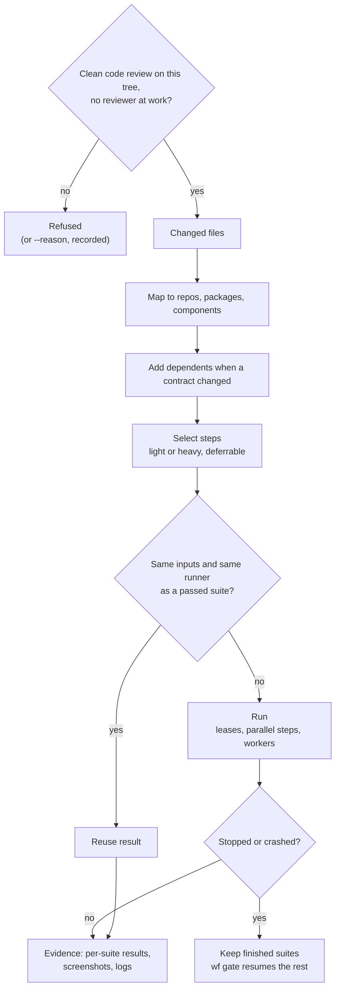

# The gate and the evidence

[Back to the README](../README.md) · [Docs map](../README.md#docs)



- **When it runs:** once per reviewed tree, after a code-review round on it came back clean, and never beside a review round. `wf gate` refuses while the latest round has open or unverified findings, no round covers the current tree, or a reviewer handed this tree has recorded no closure; `wf gate --reason "<why>"` opens the owner's decision (`override-gate`, confirmed with `wf approve`, once per tree) and, once confirmed, runs it anyway and records a `gate.override` ledger event. One out-of-order gate needs no decision: after an evidence review's blocking findings are fixed by the implementers handed after it (each closed, the tree is what they left, and no scope was added since), `wf gate` runs and the evidence review after it verifies the fix. Before the gate, `wf resume` names the open observations to place now (fix them in this pass; by default only a low one may leave, with the person's answer to its own question). While it runs, `wf handoff reviewer` is refused; the handoff after it passes is the evidence review, whose bundle carries the logs and screenshots. See [the order of work](lifecycle.md#roles-and-handoffs).
- **Stopping:** `wf stop --class major-finding|tree-change|owner-decision --reason "<why>"`. The `gate.stopped` event records the class, the reason, the minutes of interrupted step work (`discardedMinutes`), the wall-clock minutes the run had spent (`wallMinutes`) and how many steps had finished. A gate stopped by the owner's decision resumes with `wf gate` (finished steps carried); one stopped for a finding or a tree change is followed by the fix and a code-review round, then the gate. `wf status` and `wf resume` show the class and reason with the last gate and the last check (`last check: stopped (tree-change: <reason>)`); a run that ended without `wf stop` says it recorded no reason.
- **Steps are your commands,** in any language: `yarn jest`, `vendor/bin/phpunit`, `pytest`, `go test`, `gradle test`, `xcodebuild test`.
- **Per-suite results come from JUnit XML.** A plugin is only needed for what JUnit can't carry, such as screenshots or container teardown.
- **Reuse:** a suite reruns only when its inputs or its runner change. Worker counts never invalidate a pass.
- **Parallelism:** `maxParallelSteps` sets how many steps run at once. Leases (`docker`, `browser`, `simulator`) stop resource-heavy steps from colliding.
- **Workers:** `auto` sizes them from measured free memory and performance cores, never below the minimum you set.
- **Live output:** `wf gate` prints a line as each step starts and finishes (status, seconds; for a failure the first failing suite or the last 5 log lines, secrets masked), so a gate run in the background shows progress in its log. With `--json` these lines go to stderr. A failing step never stops the others. A step queued behind a full lease prints one `waiting` line naming the lease, who holds its slots (pid, and the attempt and step when a `wf` gate holds it) and how capacity is raised ([leases](#leases-for-agents-own-stacks)). While a gate runs, `wf status` and `wf resume` show the steps running, finished and waiting (with the same lease detail). An error the runner itself hits (a progress file that refuses to be written, a lease slot it cannot create) ends the run as `failed` with the error on the result: every step process is signalled, the machine-wide lease slots it took and the gate lock are freed, and every step the run started is sent SIGTERM (its process group) and the runner waits for it to end; a step that ignores SIGTERM keeps the runner, its lock and its lease until it ends, as with `wf stop`.
- **A pre-existing failing suite (0.7.28, D47):** a suite that failed in the last gate on the tree as it is, and that the delivery does not change, can be set aside by the person instead of repair rounds: `wf gate quarantine --step <id> --suite <file> --reason "<why>"` asks one reserved decision (`override-gate`) that says only what the engine checked: the change does not edit the test file, with every file it edits that the step reads, so whether the code the suite exercises changed is the person's to weigh (the agent's reason is shown as the agent's); `wf resume` names this route beside a failed gate for each failing suite whose test file the change does not edit. Once answered yes, the gate counts that step passed while that suite is its only failure (`quarantined` on the step), the evidence reviewer sees it, and the delivered comment says the suite was set aside and what was not checked. A suite the delivery changes is refused: it is the delivery's to fix.
- **Base movement:** when the base branch advances, the gate reopens only if the new commits touch the ticket's paths or shared infrastructure.

## Gate step fields

Each entry under `gate.steps` in `.workflow/project.yaml` (full example in [adapter.md](adapter.md)):

| Field | Meaning |
| --- | --- |
| `id`, `repo` or `component`, `package` | Which step, and where it runs. |
| `run` or `plugin` | The shell command, or a step plugin committed in `.workflow/`. |
| `inputs`, `ignores` | Globs the step depends on and provably does not depend on. No `inputs`: the step runs every gate. |
| `alsoInputs` | **Required for any step that builds, starts or reads a sibling repo** (an end-to-end step that runs the API from `../api`, a contract test reading `$WF_ROOT/web`). Their trees join the reuse key, so a change there reruns the step; an unreadable tree means it always runs. Without it, a passing step is reused after the sibling changed: one portal end-to-end pass was reused against old API code. `wf doctor` warns when a step's command references another repo's path without listing it. |
| `tier` | `light` or `heavy`. `--focused` runs light steps only. |
| `when.paths` | Run only when a changed file matches. |
| `report.junit`, `select` | Per-suite results and suite-level reruns. |
| `workers`, `shards`, `lease`, `deferrable` | Sizing, resource leases, batch deferral. |
| `specs` | The step's own spec files (globs, relative to its package; needs `run` with `select`). A batch member admitted with `--defer-heavy` runs the ones its change adds or edits through `select` (recorded as `ownSpecs`, with a key of its own, so it never stands for the whole step) and defers the step only when it has none; the batch gate runs the whole step (0.7.28, D47). |
| `artifacts` | Globs of screenshots and files the step writes that count as this ticket's evidence. Placeholders `{item}` (the tracker id as given, `ENG-12`), `{itemLower}` (`eng-12`) and `{attempt}` (`ENG-12.1`) are expanded per attempt (for a batch, once per member too); any other `{name}` is refused. See [Per-ticket evidence](#per-ticket-evidence). |

`sharedInfra` (per package) lists files whose change reruns every step of the package. Keep it to real infrastructure (lockfiles, root build config): a broad glob such as `scripts/**` makes every edit to a data file under it rerun everything.

## Per-ticket evidence

Every screenshot a step's `artifacts` globs match on a gate run is evidence a recorded review must have inspected (`wf accept` refuses until each sha256 is in the `screenshotsInspected` of some recorded review). An evidence reviewer therefore inspects the screenshots whose sha256 is new since the last recorded inspection: `gate.screenshots` in its bundle marks each `inspectedBefore: true|false`, an unchanged capture is not opened again, and the reviewer may look at any. A glob without a placeholder (`e2e/.results/**/*.png`) matches everything the whole suite wrote: a real ticket was refused with 1,300 screenshots from other tickets' specs, none of them its own. The convention:

- The project's UI tests write a ticket's evidence under a ticket folder (for example `e2e/.evidence/eng-12/…`, from the spec that covers that ticket), and the adapter points `artifacts` there: `e2e/.evidence/{itemLower}/**/*.png`. `wf init` drafts exactly that for Playwright (under its `testDir`) and Cypress (under `cypress/`), and no artifacts for other runners.
- Every step gets `WF_ITEM` (the attempt's item as given, `ENG-12`) and `WF_ITEMS` (space-separated items of the run: the attempt, and for a batch every member). They decide WHICH captures the tests make (for example, a spec writes its screenshots only when its ticket is in `WF_ITEMS`). WHERE they are written stays the project's convention, the spec's own ticket folder: a helper must not default every capture's folder from `WF_ITEM`, or every old spec's captures land in the current ticket's folder and become owed evidence again.
- A step whose package the ticket did not change owes nothing when its globs match nothing. A step whose globs matched nothing although the ticket changed files in its package is marked `uncovered` in the bundle (with `changedHere`): the reviewer gives a verdict, `noEvidence: [{ "step": "e2e", "reason": "why no capture is needed" }]` in the closure, or a finding that names the step. `wf accept` refuses an uncovered step without one; the verdicts are ledgered with the acceptance and shown by `wf export`. Named failure: a UI-changing ticket whose tests wrote no capture passed as "no screenshots for this ticket" and nothing flagged it.
- Every file that is matched must still be inspected. The reviewer bundle's `gate.artifacts` lists, per step and glob (as declared and as expanded), the matched files with their sha256; nothing outside the expanded globs is ever required. A criterion mapped to `kind: screenshot` must name one of those files (its sha256 or source path); `wf accept` refuses any other ref.
- Whose a capture is: for a glob, the units whose own expansion matches it (a glob without a placeholder names every unit); for a step plugin's artifact, the `units` it returns. A handoff takes the captures its own criteria cite, those tagged for its attempt id or item, and those every unit shares, the ticket's own first and every one of them (0.7.26, I-182); `wf delivery list` shows the rest of the verified captures, and `wf delivery narrow` may choose any of them.
- The adapter is read at the attempt's base, so fix the globs on the base branch before the next ticket, not mid-attempt.
- `wf doctor` warns, from the adapter alone, on every glob without a placeholder; prints each glob's matched count from the most recent gate; and warns when such a glob matched files there and that ticket changed nothing under the glob's directory.

### Captures the gate cannot collect (0.7.0, I-94)

Named failure: a ticket froze criteria that required English and Arabic, desktop and narrow screenshots, but the adapter pinned at admission had no step that writes a capture, so the full gate passed without images and acceptance found the missing route only at the end.

- **The notice.** A criterion needs screenshot evidence when it says so (`evidence: screenshot`, or a list of kinds, the vocabulary of the reviewer's evidence map) or, stating no evidence, when its `text` or `uat` speaks of screenshots or screen captures; `uat: false` (nothing to see) and `evidence: test` (a passing mention) need none. When such a criterion exists and no step of an admitted repo has `artifacts` globs or a plugin, `wf plan` and `wf criteria amend` print a warning, and `wf status` and `wf resume` repeat it until a route exists. It is never a refusal: the wording is a heuristic, and the route below always exists.
- **The route.** `wf captures import --from <folder> | --file <image> [--criteria C5,C6] [--note "how they were made"]`. The captures are made by hand on the committed tree (a dirty tree is refused), then imported. `wf` reads each png, jpeg, webp or gif once without following a link (a link, a file with another name and an empty file are skipped and named), copies it into the attempt's evidence under `captures/import-<n>/` (write-once, read-only, sha256 in the manifest like a gate artifact) and records the import in the ledger with the tree of every repo, who imported, the note and each file's save time (`madeBeforeLastCommit` when it predates the tree's last commit; information for the reviewer, not a refusal). Importing the same bytes again adds nothing; importing again from a new tree adds a new import.
- **What it counts as.** The imported files are the gate's screenshots for the tree they were made on (`screenshots` in `engine/gate.mjs`; carried across a base merge like the gate itself). The evidence reviewer's bundle lists them in `gate.screenshots` with `origin: "imported by the owner"`, `wf accept` wants each in `screenshotsInspected` and a criterion mapped to `kind: screenshot` may cite one by sha256 or source (`import-<n>/<path>`), delivery attaches them, and any later change to the tree leaves them behind exactly as it does a gate's.
- **What it refuses.** An uncommitted tree; a review of this tree already accepted (the capture would be delivered without a reviewer inspecting it); a batch without `--for <member>` (a batch's captures are delivered by the member they show); no image at all.

## Light checks, flakes and repair reruns

- **`wf check [--repo r]`** runs the adapter's light steps for the attempt's repos (only the named repos need to be committed). It is the implementer's definition of done: the bundle lists the exact steps and the command. Its results use the gate's keys, so the full gate reuses them, but a check never counts as a gate for acceptance or delivery.
- **A quick fix's gate (0.7.13):** an attempt in the quick lane runs the light steps only (lint, types, unit, build of what it touched, reused when unchanged); its heavy steps are reused when an identical pass exists and otherwise recorded as skipped (`skippedBy: quick-lane`), except one that failed in this attempt, which runs until it passes; the gate counts for acceptance and delivery, and the evidence reviewer's bundle lists what did not run (`gate.notRun`). `wf gate --full` runs them too, and a heavy step the attempt froze as a validation of its own always runs. This is the plugin's default; a project whose quick fixes should run every step sets `gate.quickLane: full` in its adapter. Screenshot evidence for a quick UI fix comes from captures made by hand (`wf captures import`). The independent review stays.
- **Scheduling:** the gate starts light steps first, then heavy steps longest first (by their last recorded duration), so wall time is not the heavy steps run in adapter order and light failures show early.
- **Flakes:** a step that failed and then passed with the same key (same inputs and runner) is recorded as `gate.flaky`, with the suites that flipped; `wf status` and the reviewer bundle show it.
- **What a step's identity is (0.7.11):** its inputs hash, the other repos' trees it reads (`alsoInputs`), its committed plugin code and its definition without the fields that cannot change a result (`workers`, `shards`, `artifacts`, `tier`, `lease`, `deferrable`, `when`, `component`, `ignores`, `prepare`). A pass with the same identity is reused. When the step's evidence globs narrowed since that pass, this ticket's files are re-selected from the recorded run (by source path and sha256); a wider glob reruns it. The workflow's own folder (the adapter, its lessons and step code) is not the project's code: a change there counts for a step only when the step's inputs name that folder, and it never makes a run full.
- **Reuse across attempts (0.7.12):** a step that keeps no evidence files (`artifacts`) also reuses a pass another attempt of the project recorded with the same identity, when the tree that run saw differs from this one in no file of the package that the step's inputs leave out. The record names the attempt (`reusedFromAttempt`), and that run's log is copied into this run's evidence, verified against its recorded sha256 (a log that cannot be read or differs makes the step run), so releasing the other attempt loses no proof. The plan finds such passes through a small index of each attempt's passed keys, kept in `.wf-worktrees/_passes/` and rebuilt when that attempt's ledger changes; it reads a ledger in full only for an attempt that holds a matching pass. A step that keeps evidence files runs for its own ticket, and `--rerun-failed` reruns the steps it names.
- **Suite-level reruns:** declare a suite report, `report: { junit: <path> }` or, for Playwright's JSON reporter, `report: { playwright: <path> }` (0.7.6: one suite per spec file), and `select: "<how the runner takes files>"` (for example `select: "--runTestsByPath {suites}"` for Jest, `select: "{suites}"` for a runner that takes paths), put `{select}` in `run`, and list the step's `inputs` (their file hashes tell a changed suite from an unchanged one). A failing step then reruns only its failed or changed suites; passing suites are carried. A suite named only in a Playwright report's top-level `errors` (a spec file that failed to load) is a failed suite. A suite with a test that did not run (Playwright reports it skipped with no result, after `maxFailures`, a global timeout or a failed dependency project) is `not-run` (also a test whose only result was interrupted): it is rerun, never carried. Where two reports or shards name one suite, failed wins over not-run, and not-run over passed. A JUnit report names only the suites that ran, so after a run that stopped early (Jest `--bail`) every input named like a reported suite (the same last two name parts, such as `.e2e-spec.ts`, so `invoice.service.e2e-spec.ts` counts) that the run did not report is rerun too. That needs suite files named with an infix (`.test.js`, `.e2e-spec.ts`); when a reported suite file is named by its extension alone (`login.ts`), the step reruns whole. A suite the gate asked to rerun that the run did not report (it died before writing, or ran something else) stays `not-run` and the step does not pass. In a Playwright run stopped as a whole (a global timeout, `maxFailures`), every skipped test counts as not run, since a test the stop cut off reads like a declared skip. A step whose run reports a test that never started (skipped with no result) does not pass, whatever its exit code. Only report files the run wrote or rewrote are read: one an earlier run left at a fixed path is not this run's. When a suite's file matches no input exactly and more than one by suffix, it names no file and the step reruns whole. `wf doctor` names each heavy, non-plugin step that lacks one of these.
- **`wf gate --rerun-failed`** runs only the steps that failed last time (reusing what still passes). Like `--focused`, it is proof while repairing and never counts.

## Scope

When the frozen plan names paths (`anchors`, `tests.changed`, `tests.run`), every changed file none of them names is outside the plan. Named failures: an implementer changed audit-read code outside the plan and the reviewer marked it minor; a capture fix and an e2e build change with `.gitignore` entries were covered by no criterion until the owner amended the criteria after the review.

- **The owner is told before the review.** `wf status`, `wf resume`, `wf check` and `wf gate` (before the run starts) print `N changed file(s) outside the plan: <every file> — amend the criteria (wf criteria amend) or fix it, before the review`, and `wf handoff reviewer` repeats it on stderr (never in the reviewer's one-line prompt). It is a warning, never a refusal. For an intended change, amend the criteria before handing to the reviewer.
- **The reviewer judges each file.** The bundle lists them under `outsidePlan` as context: the reviewer decides whether each serves the goal and raises a finding for one that does not. A verdict it chooses to give is recorded with the acceptance and shown in `wf export` (`outsidePlan: [{ "file": "app:src/audit.ts", "verdict": "covered", "by": "C2", "evidence": "C2 logs the audit read" }]`; `covered` names a criterion id in `by`, anything no criterion covers is `"verdict": "finding"` with the finding id in `by`); none is required.
- **Not scope:** a package's `docsOnly` files, files a step `ignores` (generated output), and the plugin's own `.wf-evidence/` and `.wf-worktrees/` paths. A plan that names no paths requires nothing.

## Leases for agents' own stacks

`wf run --lease docker -- docker compose up --wait` runs a command holding the same machine-wide slot a gate step with `lease: docker` takes, waiting while every slot is held, and frees it when the command exits. While it waits it says who holds the slots and how to allow more, and a slot's holder is recorded beside the slot file (`docker.1.holder`: the pid, the attempt and step of a gate, or `wf run`; a holder from an older `wf` shows by pid only). Implementers start docker stacks and browsers this way so concurrent attempts never exceed `gate.leases`.

Lease capacity is an operational fact of the machine, not part of the frozen test definition: a gate or check waiting for a slot, and `wf run --lease` waiting for one, re-read `gate.leases` from the project's current config every few seconds, so raising a lease (`gate.leases.<name>` in `.workflow/project.yaml`) unblocks a queued run without superseding the attempt. A run that used a capacity different from the one the attempt was admitted with says so and records it (`leaseCapacity`) in its result.

`wf run --step <gate step id> [--lease <name>]` runs the step's declared `prepare` command (a shell command on the step in the committed adapter, for example a dependency install that needs a registry token) in that step's package directory with exactly the secrets that list the step in `usedBy`, masked in its output, under the step's lease. It never runs a command typed on the command line: masking is not a confidentiality boundary, and agents never handle secret values. It writes nothing to the ledger and is never gate or check evidence.

## Step environment

Steps, provisioning (`install`, `onWorktreeCreate`), `wf doctor` checks and secret `verify` commands get an allowlisted environment, not the owner's whole one: the toolchain variables in `engine/env.mjs` (`PATH`, `HOME`, `USER`, `SHELL`, `LANG`/`LC_*`, `TERM`, `TMPDIR`, `TZ`, `CI`, `NODE_OPTIONS`, `XDG_*`, `SSH_AUTH_SOCK`, `DOCKER_*`, `COMPOSE_*`, `npm_config_*`, `NVM_*`, `JAVA_HOME`, `VIRTUAL_ENV`, `PYENV_*`, `GOPATH`, `CARGO_HOME`, `RUSTUP_HOME`, proxies and CA bundles, and more), every `WF_*` variable, and the catalogued secrets a step lists in `usedBy` (a repo's `provision.install` receives those that list `provision:<repo>`, [adapter](adapter.md#example); nothing else in provisioning does). Add project variables with names or `*` prefixes:

```yaml
gate:
  env:
    pass: [PLAYWRIGHT_BASE_URL, MYAPP_*]
```

The engine sets `WF_ROOT`, `WF_ATTEMPT`, `WF_ITEM`, `WF_ITEMS`, `WF_STEP`, `WF_EVIDENCE` (a scratch folder outside the evidence, copied in after the step), `WF_WORKERS` (and `WF_SHARD`/`WF_SHARDS` per shard) for every step; see [Per-ticket evidence](#per-ticket-evidence) for `WF_ITEM(S)`.

Agent-runtime variables (`CLAUDE_CODE_*`, `ANTHROPIC_*`, `CODEX_*`, `OPENAI_*`, `GROK_*`, `XAI_*`) never reach a step unless `pass` names that family itself (`ANTHROPIC_BASE_URL`, `ANTHROPIC_*`); a broad prefix such as `C*` does not count. Step plugins get the filtered environment as `ctx.env`, but they run inside the `wf` process.

## Review rules

Project documents a reviewer must read when the change touches what they govern: a design system, coding rules, an error-code catalogue. Named failure: in eleven review rounds no reviewer read any of them.

```yaml
# web project: rule files with Claude-style `paths:` frontmatter, plus a skill for UI changes
review:
  rules:
    - { id: design-system, read: [.claude/rules/design-system.md] }   # paths: from the file's frontmatter
    - { id: i18n, paths: ["src/**/*.tsx", "messages/**"], read: [docs/i18n.md] }
requires:
  skills: [{ name: ui-review, roles: [reviewer], when: { paths: ["src/**/*.tsx", "src/**/*.css"] } }]
```

```yaml
# CLI or library: public API and compatibility rules
review:
  rules:
    - { id: public-api, paths: ["src/**", "include/**"], read: [docs/api-stability.md, CHANGELOG.md] }
    - { id: cli-output, repo: cli, paths: ["cmd/**"], read: [docs/cli-conventions.md] }
```

- Each rule is `{ id, repo?, paths?, read: [docs] }`. Without `paths`, the first document's `paths:` frontmatter is used; without either, it applies to every change (`wf doctor` warns, and warns on a document not committed on the base, which is then skipped).
- The reviewer bundle lists the matching rules under `rules` (with the changed files each matched, the documents as committed at base, and `docChangedByTicket` when the ticket edited one) and the round's skills under `skills`. Both come from the adapter at the attempt's base, so a ticket cannot drop its own rules, and every reviewer gets the same list: it adds to the review and never narrows it.
- The documents and skills are context for the review: the reviewer uses them and cites a rule in a finding when the change breaks it. A verdict it chooses to give is recorded with the acceptance and shown in `wf export` (`rules: [{ "rule": "design-system", "verdict": "complies|finding|not-applicable", "evidence": "src/app/page.tsx:40, tokens section", "finding": "F2" }]`); none is required, and the engine does not read the reviewer's transcript to see whether it read the documents (0.7.0: a tool call proved no understanding).
- A skill's `when` is `visual` (screenshots were collected), `{ paths: [globs] }` (a changed file matches, so a review before the gate needs it too), or omitted (always).

## Design system checks

The shared components and the bans a reviewer must not miss, as machine-checkable rules. Named failure: a UI ticket shipped a hand-rolled `<table>` instead of the shared table component, and data tables without the shared pagination, after a blind review whose prompt only implied "follow the design system".

```yaml
designSystem:
  components:
    - { name: DataTable, path: src/components/DataTable.tsx, use: every data table }
    - { name: Pagination, path: src/components/Pagination.tsx, use: every paged list }
  rules:
    - { id: no-raw-table, description: "no raw <table>/<thead> outside the shared table", forbidPattern: "<(table|thead)\\b", paths: ["src/**/*.tsx"], except: ["src/components/DataTable.tsx"], read: docs/design-system.md }
    - { id: table-has-pagination, description: "a shared table is used with the shared pagination", pattern: "<DataTable\\b", requireWith: ["<Pagination\\b"], paths: ["src/**/*.tsx"] }
```

- A rule is `{ id, description, forbidPattern | pattern + requireWith, paths?, except?, repo?, read? }` (regexes, globs). It runs over the lines the attempt **added** (the committed diff against its base), with the adapter at base: a `forbidPattern` hit is an added line that matches it; a `pattern` hit is the first added line matching `pattern` in a file whose committed text lacks a `requireWith` pattern. Existing code is not the ticket's.
- `wf gate` and `wf check` warn with the hits. The reviewer bundle lists them under `designSystem.hits` (with the components); the reviewer judges each as context (cite one in a finding when it is a defect), and a verdict it chooses to give, `designHits: [{ "id", "verdict": "justified|finding", "evidence", "finding" }]`, is recorded with the acceptance; none is required.
- The planner and implementer bundles carry the components and rules; the planner turns a changed UI surface into a criterion "uses the shared components: <list>". The reviewer lists, for every changed UI file, each table, list, form and dialog it renders and the shared component used or the justified exception.

## Evidence integrity

The evidence (`.wf-evidence/attempts/<attempt>/`) is protected in three layers. Only the third is relied on; the first two keep mistakes from happening, the third catches what gets through.

| Layer | What it does | What it catches |
| --- | --- | --- |
| 1. Guard hook (convenience) | `hooks/guard-evidence.mjs` refuses Edit/Write/MultiEdit/NotebookEdit (and native Codex `apply_patch`) on evidence paths, and a command run with its working directory inside the evidence. It does not read shell text (details below). | An agent in Claude Code editing the evidence by habit, before anything is written. |
| 2. Write protection (accident-proofing) | Every recorded file is `0444` and, on macOS, user-immutable (`chflags uchg`); on Linux `chattr +i` when running as root with `CAP_LINUX_IMMUTABLE` (a default container drops it, and non-root cannot), else silently skipped. Folders are `0555` between commands. Only the engine lifts it, for its own writes. Root ignores modes. `wf doctor` probes and lists which layers are on. | A careless write from any tool or process (MCP tools, Codex, a script, a person) running as a normal user: it fails with a permission error. |
| 3. Manifest, verified at use (detection) | Every file the engine writes into an attempt's evidence is recorded in the hash-chained ledger (`evidence.recorded`: path, sha256, size, mode, hashed from the one read of its bytes, never through a link). Every `wf` command that opens an attempt checks the chain head against its anchor, and every recorded file: present, a regular file, recorded size and mode, no file the engine did not write, no unreadable folder; a file is re-hashed when its stat signature (size, mtime, ctime, inode, mode) differs from the one recorded after its last hash, and a file a command reads is checked against its recorded sha256 as it is read. The full check, which re-hashes every recorded file and every ledger entry of the chain, runs in `accept`, `deliver`, `verify`, `doctor` and `export`; `accept` and `deliver` also re-check, right before they record or push, that nothing verified at open has changed since. (Before 0.7.0 most commands did the full check; on a 96 MB ledger that made a read take 9 seconds.) | Any change that got past 1 and 2, made by anything: a refusal listing every problem at the next use. `wf verify [--attempt ID \| --all]` lists them. |

- **Gate steps** get `WF_EVIDENCE` (and `{evidence}`) pointing at a scratch folder outside the evidence (`.wf-worktrees/_gate/<attempt>/<run>/<step>/`); the engine copies it in after the step, and collects `artifacts` from the worktree by reading each file once (the recorded sha256 is of the bytes copied). The gate's own record of each artifact's sha256 is checked against the manifest, so a capture changed between collection and recording is refused too.
- **The anchor**: every ledger append also writes the chain head (`{ seq, hash }`) to `.wf-worktrees/_anchor/<attempt>.json`. A ledger that is truncated (down to nothing too: a `ledger.jsonl` with no entry, hence no admission entry, is reported whatever its anchor says, as is an attempt whose anchor survives while its ledger is gone: `wf verify --all` names it), restored from an older copy or rewritten without it is refused. It proves only that the ledger and the anchor agree: a process that rewrites the ledger, recomputes the chain *and* rewrites the anchor is not detected (it is not a signature, and there is no key).
- **Attempts from before 0.1.20** are adopted on first use, as found: their existing files are recorded once (a baseline, not proof of what came before).
- **Gate runs** are open only when the ledger records them started (`gate.started`) and not finished; a folder alone opens nothing. Each finished step is appended (`gate.step`); a dead runner's run is recovered from those entries, never from its progress file. A step's scratch files land under its `out/` folder (they can never take the name of the engine's log or artifacts); links in the scratch folder or the worktree are not copied or collected; reuse happens only after the earlier runs are re-hashed.
- **Links are never followed, hard links never shared.** Every engine write into the evidence, its anchor and caches opens with `O_NOFOLLOW`; an existing file is never written in place: the new content goes into a fresh exclusive file in the same folder, renamed over it (a hard link's shared data is not touched); appends (the ledger, step logs) refuse a file with more than one name. Every mode change is `lstat`, open with `O_NOFOLLOW`, `fstat` compared with the `lstat` (device, inode, one name), then `fchmod` on the descriptor. Hard links are refused at record, protect, unprotect, verify, rebaseline and copy-in (a step cannot hard-link an outside file into the evidence). Paths are judged by one function (`engine/paths.mjs`, used by the engine, the CLI's option checks, export, release and the guard hook): resolved component by component as the OS does (a link followed before a following `..`), names compared separator-bounded (`.wf-evidence-x` is not `.wf-evidence`), case and Unicode forms folded on a case-insensitive volume, trailing slashes and `.` ignored. A link planted at any evidence entry is refused by name; its target is left byte-identical, mode and flags unchanged (tested on macOS with `uchg` and on Linux with `chattr +i`).
- **What stays path-based** (Node has no `openat`/`fchflags`): `chflags`/`chattr` (each entry is `lstat`ed before and after; a swap in between has the flag change undone on whatever was swapped in, and the call refuses), `rename`, `unlink`, `mkdir`, `readdir`, and the check that each folder below `.wf-evidence` is a real folder before a file is opened in it. A folder swapped for a link in that window is not prevented; the next verification refuses it.
- **Repair.** A file changed outside wf (a tool, a disk problem, a person fixing something) does not brick the attempt: `wf verify --accept-changes --attempt ID` lists each difference (changed, added, removed; old and new sha256), and only with `--reason "<why>"` appends `evidence.rebaselined` with the reason and every path and hash. `wf status`, `wf export` and the reviewer's bundle then show it. A missing file is accepted only as removed; a link or a non-regular file must be replaced first; the ledger itself (chain, anchor) is never re-baselined.
- **Release.** `wf evidence release [--attempt ID | --closed | --older-than DAYS] [--reason "why"] [--dry-run]` deletes closed or abandoned attempts' evidence: one rename out of `attempts/` (so a failed delete never leaves a half-listed attempt), the protection lifted by the engine, then the delete; a tombstone anchor refuses a ledger reappearing under that id. Nothing else deletes evidence (closing removes worktrees and scratch folders only); never `rm -rf` it by hand.
- **Measured** (`node bench/evidence.mjs`, Apple M4 Max, macOS, immutable flag on; one attempt with 6,346 evidence files, 1.45 GB: 1,320 screenshots of 0.2-1.2 MB, 20 logs of 5-50 MB, 5,000 small files): `wf status` 0.46-0.49 s, `wf resume` 0.57 s, `wf verify` 1.08 s, `wf handoff reviewer` 1.48 s, `wf review` 1.23 s, `wf accept` 1.38 s, `wf deliver` 8.65 s (of which most is exporting the 1,320 screenshots for viewing), the gate that wrote and recorded the fixture 6.04 s.
- **Linux** (checked in a `node:22-bookworm` container on OrbStack): as non-root the modes apply and `chattr +i` is off (needs root); as root the modes stop nothing and `chattr +i` fails with "Operation not permitted" unless the container has `CAP_LINUX_IMMUTABLE` (then it works on overlayfs and tmpfs). Every case degrades silently and `wf doctor` says which layers are on; detection works in all of them. The suite passes there as root and as non-root.

**Accepted limits, plainly.** This makes careless writes fail and every other change visible at the next use; it does not stop a determined process running as the same user:
- such a process can lift the protection, rewrite files, the ledger, recompute the chain and rewrite the anchor consistently; nothing local can prove otherwise;
- while a `wf` command runs, the attempt's folders are writable for it: a file planted *during* that command in the folder of the gate run it is recording, or a recorded file changed before the command records it, is recorded as the engine's (the gate's own artifact hashes still catch a changed capture);
- reading is not controlled: Read, Grep and Glob are allowed (reviewers need them), so the **blind-review** property cannot be proven from file access. It rests on the ledger-name independence check (a reviewer is not the owner, the planner, an implementer or an earlier round's reviewer; a fresh id each round) and on the reviewer reading only what its bundle names. The engine does not read the reviewer's transcript to prove its prompt or its reads (0.7.0: four refusals of that kind in the field, all benign);
- the engine's own reads of an input file (`--file`, `--capture` ...) are checked, then read: a file swapped between the two is read as swapped.

### The guard hook (layer 1)

The hook (matcher `Edit|Write|MultiEdit|NotebookEdit|Bash`) is registered globally. Threat model (`docs/trust-model.md`): agents are fallible, not adversarial, so it judges the targets of file tools and the working directory, and never reads shell text. Named failure (0.7.0): its earlier Bash text-scanning branch made 334 refusals in the field, none a write attempt and 229 naming no evidence folder at all (any `$` or backtick next to `wf-`), and it blocked the engine's own recovery advice. A write through a shell is not a mistake an agent makes by accident, and layers 2 and 3 catch it afterwards.

- **File tools:** an `Edit`, `Write`, `MultiEdit` or `NotebookEdit` target, or a native Codex `apply_patch` target (a rename included), that has a `.wf-evidence` path component, as written or as the OS resolves it (symlinks followed, case and Unicode forms folded), is refused, whatever else the input carries. The content written is not inspected (a closure may cite evidence paths). A malformed `apply_patch` payload is refused.
- **Working directory:** a command run with its working directory inside the evidence is refused.
- **Everything else passes**, a Bash command that names the evidence folder included, and input the hook cannot read.
- **The refusal says what to do** (I-16): the Read tool or `wf evidence list` / `wf evidence show <path>` to read, `wf export screenshots` for images, a `wf` command to change recorded state.
- **`wf evidence list [--kind K] [--attempt ID]`** lists the attempt's evidence files by kind (ledger, plan, handoff, review, gate log, gate record, tracker, delivery, issue, screenshot, other) with their paths relative to the attempt folder and their full paths. **`wf evidence show <path>`** prints a text file given by that relative path. Both write nothing of their own (opening the attempt runs the usual evidence verification, as every `wf` command does). A link at the attempt folder is refused. Files are listed by kind; an entry that is not a regular file is listed as such and never read. `show` refuses an absolute path, `..`, a path outside this attempt's evidence, a link, a file with more than one name, a binary file and an image (it points to `wf export screenshots`). It reads and prints at most 4 MiB and says when it cut the file. Nothing in either command needs the folder's name.
- **`wf` itself** checks its own paths, once: every path option (`--out`, `--csv`, `--handoffs-csv`, `--html`, `--dir`, `--to`, `--root`; `--file`, `--capture`, `--summary-file`, `--closure`, `--issue-file`, `--from`) is resolved by `engine/paths.mjs` as the OS will resolve it, validated, and replaced by that resolved path, which is what is then opened or written; each input file is read once (the bytes checked are the bytes kept). Refused: anything in the evidence (written or read), an empty value or a missing one, a URL (`file://`), a `~` the shell did not expand, a trailing slash on a file input, a folder where a file belongs (and the reverse), and a path option given twice. Attempt ids and skill names must be plain names. Cleanup at close deletes nothing through a link and leaves anything uncertain in place.
- It sees only the tools its matcher names in Claude Code; everything else, and every write that gets past it, is covered by layers 2 and 3.

## Required validation discovered after admission

Commit the added step definitions and single-file plugins in the attempt's adapter repo, then register only new IDs:

```sh
wf validation add --steps http-proof,browser-proof --criteria C2,C3 --reason "Required real execution and captures" --attempt ENG-1.1
```

Registration requires a clean committed product tree, frozen criteria, an admitted adapter repo and no active role
or gate. It records the adapter commit, exact selected definitions, criterion references, reason and permitted
existing secret-key bindings in the ledger. Existing IDs cannot be replaced; the admission adapter pin never moves.
All admission checks, rules, roles, environment allowlists, secret stores, concurrency limits and delivery targets
remain frozen. Only existing catalogued keys may acquire a new binding through the committed secret catalog.

Registration clears prior acceptance and invalidates the old gate. Obtain a fresh code-review round before the
next full gate. Review each added definition and its single-file plugin at the recorded commit, not a later edited
copy. The reviewer judges each registered step as context (a verdict it chooses to give is
`validationChecked: [{ id, commit, verdict: complies|finding, evidence, finding }]`, one entry per step; none is
required). Then run the normal full gate and a fresh evidence review. When the step was registered for a blocking finding an evidence review raised ("the required check never ran in the gate"), the code review after the registration cannot verify that finding before the check has run: it keeps the finding open with evidence, and the gate order does not wait for it (0.7.23, I-179). Acceptance still does: only an evidence round written after the gate verifies it. Missing, skipped,
deferred or failed supplemental execution is not passing proof. Reports and captures use the ordinary sealed
evidence, no-follow, reuse, redaction, cleanup and screenshot-inspection paths. Direct diagnostic reports cannot
be imported as prior execution. Registration is additive: it cannot remove or overwrite a step.

### Correcting a registered check (0.7.0, I-102)

Named failure: review found a defect in a registered single-file plugin; fixing and committing it left the gate running the defective plugin pinned at registration, for ever. Commit the corrected definition or plugin in the adapter repo, then:

```sh
wf validation correct --steps http-proof --reason "review found the plugin passes without checking the response" --attempt ENG-1.1
```

A correction keeps every obligation registration carries: a registered supplemental step only (an admission step is corrected too, as the person's decision (I-125), asked once for the steps and the definitions and plugin code they are corrected to: a base merge that moves HEAD and leaves those alone neither asks again nor loses the person's answer, and a change to them asks afresh (0.7.27, I-187); a new one is `add`), no active role or gate, a clean committed tree, an admitted repo and package, existing catalogued secret keys only, a recorded reason, and a commit that descends from the admission commit and now from the commit the step is pinned at (a pin moves forward, never sideways or back; a commit that equals the pin has nothing to correct). The criteria the step was registered for are kept unless `--criteria` names others. The ledger keeps both pins and both definitions (`validationCorrections`); the corrected steps form a new record at the new commit. Like a registration it clears prior acceptance and invalidates the old gate, so a fresh code review (whose delta bundle carries the re-pinned step and the pin it replaced) and a full gate that runs the corrected plugin come before the evidence review.

