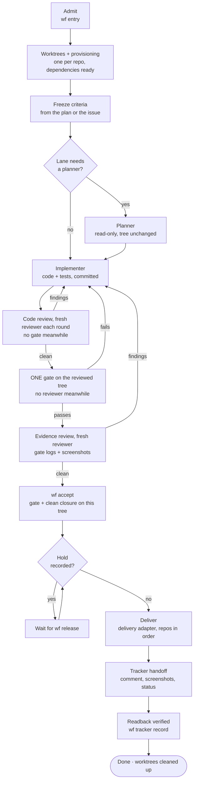
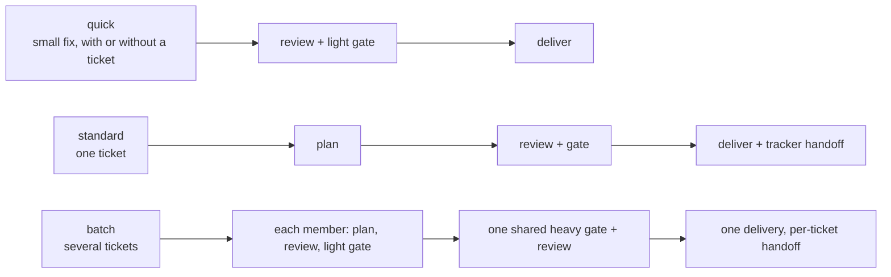

# The lifecycle, lanes, roles and work classes

[Back to the README](../README.md) · [Docs map](../README.md#docs)

## The lifecycle



| Step | Command | What the engine checks |
| --- | --- | --- |
| Admit | `wf entry` | Intent is `implementation` or `analysis`. Analysis can never deliver. |
| Worktrees | automatic | One worktree per repo; dependencies cloned or installed; ignored files like `.env.local` copied in. |
| Criteria | `wf plan --from-agent <planner id>` | Criteria and every plan section are frozen before implementation, taken from the planner's transcript unchanged; unknown top-level keys are refused. For cross-cutting work the plan carries the two-stage [impact analysis](#impact-analysis), whose queries the engine re-runs. Later changes go through `wf criteria amend --reason`; one that adds scope owes an impact update, and the next implementer is told when it is still owed (information, not a refusal). On an accepted attempt, one that adds or re-words a criterion (or adds a repo) withdraws the acceptance: the criterion was judged by no review (below). |
| Plan | `wf handoff planner` | The planner leaves the tree unchanged. |
| Implement | `wf handoff implementer` | Changes are committed before review and the gate. An implementer handed without `--work` covers every work item no implementer has started (on an attempt admitted before 0.7.0, which recorded no cover, one covers every item that existed when it was handed and no `--work` handoff names). A fix handoff (blocking findings open) lists them by family; a [pattern sweep](#fix-rounds-fix-the-pattern) per family is optional, and the implementer answers each family with one proof in its report. |
| Review | `wf handoff reviewer`, `wf review` | Allowed once the work is committed, every implementer handoff is closed, and (with more than one work item, from 0.7.0) the combined tree has a passing `wf check` (`wf handoff close --agent <id>`; `--reason` hands the tree anyway and records `review.override`), never while a gate runs on the attempt. The reviewer isn't the owner, planner, an implementer or a reviewer of an earlier round. Independence is checked from ledger names; a round the engine launched (`wf handoff run`) records its session id, and one whose launch failed is refused. The closure is bound to the tree it was handed (a round refused because the tree changed leaves a `review.refused` ledger event). A round is `full` (the attempt's first review, and its first evidence review) or `delta` (every other round, an evidence review after a fix included) ([review rounds](#review-rounds-blocking-findings-and-observations)); a full round's closure is blind and earlier rounds' blocking findings are revealed after it, a delta round is handed them up front. A reviewer handed screenshots records `anomalies`: "none seen", or each one with the screenshots, what differs and a finding, or its investigated cause and the evidence for it (I-12; the test assertion that pins the value is welcome, not required; `scenarios/review-anomalies.test.mjs`). |
| Gate | `wf gate` | Only after a clean code review on this tree: refused while the latest round has findings that block (or earlier ones it did not verify), no round covers the current tree, or a reviewer is at work (`--reason` asks the owner to confirm the skip with `wf approve`, once per tree, then records `gate.override`). Each step's evidence is hashed. A newer failure beats an older pass. One out-of-order gate needs no approval: after an evidence review's blocking findings are fixed by the implementers handed after it (each closed, the tree is what they left, and no scope was added since), `wf gate` runs and the evidence review after it verifies the fix. Before the gate, `wf resume` names the open observations to place now (fix them in this pass; by default only a low one may leave, with the person's answer to its own question). |
| Discovered issues | `wf discovered add\|list\|rate\|close` | Every issue found during the ticket is recorded and ends fixed by a commit of this ticket or deferred by the person's rule (D17): medium and high are fixed in this delivery, a low one leaves only with the person's answer, one short question per item (D18; the project's `leaving:` may change who decides); the reviewer bundle lists them as context. |
| Accept | `wf accept` | On the current tree: a passing full gate, a closure with no finding that blocks, written after that gate passed (the evidence review). Every criterion maps to evidence or a justified n/a, and every gate screenshot has been inspected by a recorded review (the evidence reviewer lists the ones new since the last inspection). |
| Deliver | `wf deliver [--summary-file F]` | Implementation intent, no hold, review accepted, no discovered issue open, no review observation unresolved (fixed, ticketed or moved); the owner's summary recorded when a delivered comment is posted. |
| Shown | `wf shown` | Every delivered screenshot shown to the owner with a caption the owner wrote, and the anomalies seen (or "none seen"); nothing owed when none were delivered. |
| Handoff | `wf tracker record` | From the raw tracker output: the status, the comment `wf` rendered (with every screenshot inline) and every delivered screenshot as an uploaded file with its caption. |

A stopped or interrupted attempt resumes with `wf resume`, which says exactly what's next. With more than one open attempt, every command it prints carries `--attempt <id>`.

### The plan file

`wf plan --from-agent <planner id>` reads the planner's last ```` ```yaml ```` block from its Claude Code subagent transcript (found by the name it was started with), so the owner never retypes it. `wf plan --file <file>` takes the same YAML from a file. For native Claude Code or Codex, run the handed planner with `wf handoff run --agent <id> --attempt <id>` first: wf launches a fresh native process for the handed runtime with the frozen start line and role settings, records the returned session id, and verifies the actual host prompt before importing its YAML. An encrypted desktop spawn cannot use this route retroactively; it needs the unchanged reply file and remains unverified. A Codex handoff never searches a Claude transcript. A planner output `wf plan` cannot read as a plan (a transcript with no fenced YAML block, YAML that does not parse) and a `--file` that does not parse are kept unchanged with the refusal (`plan.refused`, I-114) and handed to the next planner in its bundle's `priorPlanRefusals`, as a plan the validators refuse is; a refusal about who was handed the planning, or a file that cannot be opened, is the owner's and records nothing. The plan sections (`summary`, `contract`, `anchors`, `tests`, `doNotRun`, `externalServices`, `agentSplit`, `expect`) may sit under `plan:` or at the top level beside `criteria` and `work`; `expect: { files, rounds, minutes }` is the planner's own prediction and a plan without it is refused (the engine shows it beside what happens; a quick-fix plan carries one too); `plan:` may also be plain text (the summary). Any other top-level key is refused with the list of known ones, because a section the engine does not read never reaches the implementers. Every section is stored in the frozen plan and handed to the implementers and reviewers in their bundles, `expect` excepted (a prediction, not a target). A criterion may state its evidence (`evidence: screenshot`, or `test`, `output`); when it names screenshots (stated, or in its `text` or `uat`) and no gate step of the attempt can collect any, `wf plan` and `wf criteria amend` warn, `wf status` and `wf resume` repeat it, and the owner brings in captures made by hand on the committed tree with `wf captures import` ([gate](gate.md#captures-the-gate-cannot-collect-070-i-94)); it is a warning, never a refusal.

### Impact analysis

Named failure (I-26): a cross-cutting ticket was planned in a few minutes from a count of where one shared component appeared. The planner never characterised how each consumer behaved (data source and limit, write paths, empty, error, phone layout, sorting, totals) and never opened the other repo; its bundle's `impact` was empty because the engine derives impact from a diff, and none exists before planning. Most of the work added later, and most review findings, were one search away on the base commits.

The planner writes two stages in its plan, in this order, and `wf plan` checks both:

1. **`survey`, before the design**: what exists around the issue. `queries` (below), then `components` (one row per affected component: `file`, the `query` that found it, and what matters for this change among `endpoint`, `limit`, `writePaths`, `paging`, `empty`, `loading`, `error`, `permission`, `mobile`, `rtl`, `publicApi`, `sorting`, `reorder`, `clientTotals`, `rawEnums`, `tests`; these are things to look at, not a form: no column is required), `consumers` (`symbol`), `flows` (`flow` and its `failure` path) and `patterns` (defects that may recur). Every entry has an `id`, its `query` and that query's `hits`; a component row's `file` must be a hit of its query.
2. **The design**: `plan`, `criteria`, `work`.
3. **`impact`, after the design**, derived from it: `changes`, one per changed symbol, endpoint, DTO, error code and migration, each with `element`, `kind`, `cites` (a criterion id, a work item id, or text from an anchor or the contract: an entry that cites nothing in the design is refused), `covers` (survey ids), `consumers: { query, hits }`, `flows` (each with `failure`), `contracts` crossed and `suites` that must run (each with `query` and `hits`), and `work` when the plan has work items. Every survey entry is covered by a change or listed under `excluded` with a `reason`. `impact.queries` holds queries the design adds (callers of a new symbol, tests asserting an old schema).

**Queries are data, run by the engine.** `{ id, pattern, kind: literal | regex, repo?, paths?: [globs], exclude?: [globs], unit?: files | lines, ignoreCase?, hits }`. The engine lists the committed tree (the attempt's worktree HEAD for a repo in the attempt, else that repo's base branch), reads each blob itself, matches the pattern per line (a literal in its own process; a JavaScript regular expression for `regex` in a child process stopped after `impact.regexTimeoutMs`, 20 s, so a pattern that backtracks without end is refused, never a hang), and counts files (or lines). The repos it reads and these limits come from the adapter as committed at the attempt's base, never the working tree's copy. No shell runs; a pattern is never a command. Globs (`paths`, `exclude`, and every glob in the adapter) are matched without backtracking, in time proportional to the glob's length times the path's: `**` any depth, `**/` zero or more folders, `*` within one folder, `?` one character, `{a,b}` alternatives (a `{` with no closing `}` is a literal); a query glob whose alternatives expand past 256 is refused before any tree is read. A binary file (a NUL in its first 8000 bytes) is listed and holds no hit; a text file over `impact.maxFileBytes` (2 MiB) refuses the query (exclude it or raise the cap), and so does a query that reads more than `impact.maxScanBytes` (512 MiB), a missing worktree, an unreadable blob or any git failure: a count is never taken from a partial read. `wf plan` re-runs every query and refuses a recorded `hits` that differs from what it finds, so a count cannot be invented. `wf impact run --attempt <id>` runs the recorded queries on the current tree, `--file <plan>` a plan file's, and `--query '<json>'` one query (for a read-only planner checking a count).

**When it is required.** For a lane that has a planner, when any work item (or, without work items, the implementer role) runs at a class the adapter lists under `impact.requiredFor` (default `[full]`). A plan with a design and no survey, or no impact map, is then refused. A plan that is not required to carry the stages may still carry them; they are then checked the same way. The quick lane has no planner and needs none.

**Amendments.** An amendment that adds or changes criteria, replaces the work items or adds a repo owes an impact update when the attempt carries an impact map (or its classes require one). Put `impact` in the amendment file: new `queries` and `survey` entries for the added scope, `changes` citing the new criteria or work items, `excluded`; or `impact: { unchanged: "<why the amendment adds no element>" }`. It is checked like the plan (new query ids, counts re-run, every new survey entry covered or excluded). An amendment file may carry only `impact`. It applies `criteria`, `expect`, `impact`, `scope`, `work` and plan sections (`plan`, or `summary`, `contract`, `anchors`, `tests`, `doNotRun`, `externalServices`, `agentSplit` at the top level): a restated section replaces the frozen one, and what it replaced stays in the record (`planHistory`; 0.7.10, I-120). Any other field that would be lost (a changed `survey`, an unknown key) is refused rather than dropped (I-127; attempts admitted from 0.7.9). Until it is recorded, the implementer's bundle says the update is owed (`impactOwed`) and asks it to find and report the consumers the added scope reaches; nothing is refused.

**The reviewer re-derives it.** The reviewer bundle carries `impactMap`: the survey, the impact map, every addendum, the recorded queries and counts, the `inventory` of survey and impact ids, and `derived`: symbols the final diff declares or edits (declarations on changed lines and the enclosing function git names in each hunk) and, for each, the files that use it outside every file the map lists (`outside`; the adapter folder is left out). The reviewer runs `wf impact run`, judges what is new or gone and reads the outside callers; `impactChecked` is its notes in any shape, never a quota (0.7.0: the reviewer-side sampling cap and shape refusals went; the planner-side check that the plan's counts match the re-run query stays). A finding the map missed carries `"category": "impact-gap"`. `wf report` counts `impactGaps` per attempt: findings outside the map, a direct measure of the plan.

The derived scan is explicitly `mode: textual`, with `structuralCoverage: unsupported`. It extracts only regex-recognized declarations and hunk names, scans at most 200 unique names, and lists at most 100 outside text matches. `totalSymbols`, `analyzedSymbols`, `symbolsTruncated` and `incomplete` expose the bounds; `truncated` continues to mean the outside-match list was capped. `declarationOrigins` preserves every known origin for each analyzed name; an outside match with `originAmbiguous` is not proven to reference its legacy `declaredIn` origin. Comments, strings and unrelated equal names require reviewer judgment. Imports, aliases, members and dynamic/generated relationships are not structurally resolved. Existing closure fields remain unchanged.

Applicable rules with missing documents at the frozen base refuse reviewer creation. Missing, unreadable, empty, linked, invalid UTF-8 or oversized (over 4 MiB) handed documents refuse readiness; native reviewer launch rechecks the exact handed paths before recording/spawning a child. Unrelated rules do not block a handoff. This checks document availability; whether the reviewer read each document is not checked (0.7.0 removed transcript read receipts: a tool call proved no understanding). Existing tree, implementer, lesson and authorization checks remain in place.

### Fix rounds fix the pattern

Named failure (I-25): fix briefs targeted single findings, so the same defect pattern recurred over many review rounds (an empty later page losing its pager, a failed Next stranding the user, raw enum codes on screen). Named failure (0.7.0): answering the sweep hit by hit turned 11 findings into 1,059 hits and 431 changed files, and an owner-written query steered the implementer's search. An implementer handoff while blocking findings are open is a fix handoff: its bundle's `repair` lists them by `family` (a stable key a reviewer gives a defect pattern; a finding with none is its own group). The implementer finds the real instances of each family and fixes them at the cause, and answers each family with one mechanical proof (a query, lint rule or test and what it returns once the family is clean) in its report's `proofs` or in a commit trailer, `Sweep <id>: proof - <command> => <expected result>`. A sweep is optional: `wf handoff implementer --sweep <file>` names one per family when the owner already knows the pattern (`sweeps: [{ finding: "<reviewer>:<id>" (or family: "<family>"), why, query: { pattern, kind, repo, paths, exclude } }]`, naming all the families or only some of them); the engine runs each query (ids `S1`, `S2`, ...), prints the hits and puts them in the bundle's `sweep`. Nothing is refused for a missing or unanswered sweep: the next reviewer bundle lists the fix pass's `sweeps` with the query, the hits at the handoff and now, and the answer, and the reviewer re-runs the proof instead of re-judging each hit. A handoff closed `--outcome stopped` or `failed` did not do the fix round, so it spends no sweep (I-79, I-89): the replacement may be handed its own `--sweep` for the same findings, and the next reviewer's `sweeps` leave out a stopped handoff's sweep unless a trailer answered it. A handoff still open, or closed done, has spent the sweeps it was handed.

**Restrictions the diff has outgrown.** Named failure: a plan's `doNotRun` banned one repo's suites ("no source changes there"); the ticket later changed that repo, the ban stayed, and a stale public-API test reached review that the banned suite would have caught. `wf handoff` and `wf criteria amend` warn (on stderr, never in a reviewer's prompt) when a `doNotRun` entry or `externalServices` names a repo the attempt's diff now touches, or a gate step of such a repo.

### Review rounds, blocking findings and observations

Named failure (0.7.0): the exit condition "a fresh blind reviewer finds nothing on the whole tree" never held. Reviewers found about two issues per hundred tool calls whatever the model, one ticket ran 47 rounds, and the last rounds raised findings on older code the ticket merely touched (none of 24 on lines changed since the round before). Release 0.5.14 had forced every review to run to completion, and one review grew from about 100 to 1,183 tool calls.

- **Round mode** (`engine/review-policy.mjs`). `full` for the attempt's first review and its first evidence review (a gate passed on this tree), at most two per attempt: a blind audit against the criteria, the invariants, the plan and the diff, with the open items only (open or deferred discovered defects, the impact map, the rules). `delta` for every other round, an evidence review after a fix included (its bundle adds the new gate evidence, and it maps every criterion): the bundle holds the diff since the last reviewed tree (`delta`: diff commands, changed files, line ranges), the findings still open (`openFindings`, handed up front, so the closure answers them in `priorFindings` at once with no second submission), the criteria and the invariants, and never the attempt's history (amendment texts, fixed discovered items, bookkeeping). A delta round is a single reviewer. A handoff that was never recorded (refused, tree moved, a launched reviewer that ended with no closure) was not a full audit, so the next round is full again; and from 0.7.4 neither is a recorded closure that names scope it did not reach (`notReached`): such a round is shown to the owner (`wf resume`, `wf signals`, `wf export`), to the next reviewer (the bundle's `unreachedBefore`: coverage that adds to its goal and narrows nothing, so a full round stays blind to findings) and in the delivered comment (each item, from every round since the last complete full audit, as "Not checked by review"), and it is not counted as the audit. Except (0.7.10, I-133): a full evidence round the engine found covered when it was recorded (every criterion mapped to evidence acceptance would take, every screenshot new to it opened) is the audit whatever it names under `notReached`; what it names is still shown to the next reviewer and in the delivered comment. Acceptance takes it as it is: whether unreached scope matters is the owner's judgement. Every reviewer bundle lists `followUps`: findings that left the delivery (ticketed, moved or deferred) and why. In a batch, a finding on a line one member's accepted commits wrote (`git blame` on the batch head) is that member's and does not open a batch round; lines the batch itself wrote do. What may leave a delivery follows the person's rule (D17): medium and high are fixed in this delivery, a low one leaves only with the person's answer, one short question per item (D18; the project's `leaving:` may change who decides).
- **Scope, not a clock.** A delta review is complete when its changed lines and the open findings are judged; the delta is what bounds it. The engine gives no reviewer an effort budget (it once gave 60 minutes for a full audit and 25 for a delta, a number it had picked; an adapter that still sets `review.budgetMinutes` is accepted and ignored). The reviewer states its plan early in its closure file (`scope`, `expect: { minutes }`), and records what it checked and names what it did not reach (`notReached`), ending with a recorded closure (`wf review --closure`) however large its input is; `wf resume` shows its expectation beside its elapsed time while it works (strategy.md).
- **What blocks.** The engine classifies each finding when its closure is recorded and stamps the result on the finding. It blocks the gate and acceptance only when it cites a frozen criterion the change fails (`criterion`), breaks a critical invariant (`invariant`), or is a regression on a line the attempt changed (computed from git: the finding's `file` and `line`, or the `path:line` in its `evidence`, against the attempt's diff against its base; in a delta round, against the lines changed since the last reviewed tree), and it is rated medium or high, or not rated. A finding rated low never opens a round, in any round: it is an observation (one that fails a criterion or breaks an invariant is high whatever its rating). A full-round finding that cites no location, criterion or invariant blocks until a later round locates it or verifies it; in a delta round it is an observation. Severity is one scale for every reviewer and implementer: **high** = a user, a tenant or the business is harmed or blocked (wrong or lost data, a broken flow, security, money, a visible defect on a primary screen); **medium** = degraded but usable (a secondary flow, an edge case, a confusing state); **low** = polish (wording, spacing, naming, style); a tenant-isolation, authorization or money defect is always high. A later reviewer who verifies a finding still open may re-rate it (`priorFindings: [{ round, id, status, evidence, severity }]`); re-rated low it stops opening rounds, but where it may go keeps the higher of the two ratings. The four-boolean scope form and "uncertain causality stays blocking" are gone.
- **Observations.** Every other open finding is an observation: recorded, never a new round by itself. It ends fixed (a later round verifies it in `priorFindings`, or the owner records it with `wf scope fixed --finding <round:id> --commit <sha>`: a commit made after the finding was raised, undone when a later reviewer finds the finding still open, and for a high observation still followed by a reviewer's `fixed` before delivery), ticketed (`wf scope ticket --finding <round:id>[,<round:id>] --capture <raw readback>`), moved to a sibling attempt of the batch (`wf scope move --finding <round:id> --sibling <attempt>`; it asks nobody, since the obligation stays in this delivery, but a finding on a line this attempt changed stays here) or left for later as a known issue (`wf scope defer --finding <round:id>[,<round:id>]`, listed in the delivered comment); `wf deliver` refuses with `review:observations-open` while one is unresolved. Whether one may leave the delivery follows the person's rule (D17): medium and high are fixed in this delivery, a low one leaves only with the person's answer, one short question per item (D18; the project's `leaving:` may change who decides). A finding that blocks never leaves; the person may waive it (`wf scope waive`). `wf scope list` shows each open finding, whether it blocks, its family and where it went.
- **Families and sweeps.** See [fix rounds](#fix-rounds-fix-the-pattern).
- **Discovered issues.** `wf discovered add --kind bookkeeping|defect` (default `defect`) with `--severity high|medium|low`, and `--invariant "<which>"` when the defect breaks a critical invariant of the project (that makes it high; an implementer's report marks a `left` item the same way with `invariant`). `wf discovered rate <id> --severity <s> --reason "..."` re-rates one: raising is free, lowering records its reason and, out of high, needs the person's `wf approve`. An implementer's own lint or fixture fix is bookkeeping, closed with the fix commit in the same handoff: it is never in a reviewer bundle (512 of 595 discovered items in one ticket were such fixes). A fixed defect is history, not a bundle item either; open and deferred defects are handed to the reviewer as context. Closing one as deferred follows the person's rule (D17): medium and high are fixed in this delivery, a low one leaves only with the person's answer, one short question per item (D18; the project's `leaving:` may change who decides) (`wf scope defer --finding <ref>,D1,D2` puts review findings and discovered issues to the person together, one short question per item); every deferral is listed at delivery automatically.
- **Placement is not obligation.** Nothing broken is dropped, but where a fix lives can change: a defect this change caused or exposed stays in this attempt, and one on a critical boundary never leaves the delivery without `wf approve`.

Role texts: [scope-decisions.md](scope-decisions.md).

### Recovering from an adapter fault

An attempt is pinned to the adapter (`.workflow/`, the delivery adapter included) as committed at its admission. When the delivery adapter reports a state that is not documented, `wf deliver` refuses with the state it received, and committing a fixed adapter on the base branch does not by itself reach the running attempt (proven: `scenarios/delivery-adapter.test.mjs`, "a broken delivery adapter"). Every claim below is proven by the scenario named after it; the scenarios are in `scenarios/adapter-fault.test.mjs` unless another file is named.

**The change is already on the target branch** (the adapter pushed, then reported something other than `integrated`). Named failure (I-20): the next `wf deliver` counted such a repo as delivered from git ancestry alone and never asked the adapter again. Now:
- The last state the adapter reported is recorded (`delivery.integrating` in `wf status --json`), and every retry asks the adapter again (`observe`, then `readback` when it reports `integrated`) ("I-20: an adapter that merged and then reports ci-failed ..."; `scenarios/discovered.test.mjs`, "0.7.0: the same plain wf deliver command is retried after an adapter waits and after its readback fails": a failing readback keeps refusing on retry).
- A pending state (`awaiting-merge`, `ci-running`) waits with exit 0 and says the change is already on the target; once the adapter reports `integrated`, it delivers with no acknowledgement ("I-20: a pending state after the merge waits ...").
- Any other state after the merge (`ci-failed`, `rejected`, an undocumented state or none) refuses and names the state. It counts only once the owner has seen it and acknowledges that repo and that state: `wf deliver --acknowledge-adapter-state <repo>:<state>` (`<repo>:none` for no state); a failed check (`ci-failed`, `rejected`) also needs the owner's `wf approve`. An acknowledgement of another state does not count. The delivery record keeps the state and the acknowledgement, and the delivery output prints it under "not a clean adapter delivery" ("I-20: an adapter that merged and then reports ci-failed ..."; "I-22: an adapter fault after the change merged into the base ...").

**The change is not on the target branch.** Named failure (I-21): when the adapter faulted after another repo of the same attempt was delivered, every retry refused, `wf abandon` refused, and the fixed adapter on the base branch never reached the attempt. The supported recovery for every shape of attempt:
1. Commit and push the fixed adapter on the base branch of the repo that holds `.workflow/`.
2. `wf deliver --repin-adapter --reason "<why>"` refuses and shows what would change: the current pin and the base tip (each with its delivery kind), the adapter files that differ, what is already recorded as delivered or skipped and what is still to deliver. Show it to the owner.
3. Once the owner has seen it, `wf deliver --repin-adapter <tip> --reason "<why>"` (the tip as printed) asks the owner to confirm the re-pin with `wf approve`; run it again after they have. It records `adapter.repinned` in the ledger with the old and new pin, the reason, the changed files and what was already delivered, then delivers the remaining repos with the adapter read at the new pin. The same command is accepted again when a later step fails after the re-pin was recorded, and the re-pin is recorded once (`scenarios/adapter-fault-shapes.test.mjs`, "I-22: quick lane ...").

The trust rule does not change: the adapter is read from the base branch as fetched from its remote, never the working tree. A fix only in the working tree, or committed but not pushed, is refused as "nothing would change"; a wrong commit or no `--reason` is refused and records nothing ("I-21/I-22: a broken adapter, single repo after `wf base merge` ..."). A tip that does not contain the current pin (a rewritten base branch) is refused too (same scenario). Only delivery reads the new pin: the gate, the review and the tracker stay on the admission pin (`adapterBase`), and the re-pin is shown in the delivery output.

Proven for each case:
- **Single repo, standard lane, after `wf base merge`**: "I-21/I-22: a broken adapter, single repo after `wf base merge` ...".
- **Several repos, one delivered before the fault**: `wf abandon` refuses and names each recorded repo as delivered (with its commit and target) or skipped, and points to the re-pin; the re-pin delivers the rest, and the repo delivered before keeps its record ("I-21/I-22: several repos, one delivered ...").
- **Several repos, the unchanged one recorded as skipped before the fault**: the re-pin delivers; `wf abandon` is also accepted, because a skipped repo pushed nothing (the abandon record lists the skipped repos), once the owner acknowledges the faulted repo's integration as below (`scenarios/adapter-fault-shapes.test.mjs`, "I-22: several repos, the unchanged one recorded as skipped ...").

`wf abandon` never takes back a change that may land: it refuses while any repo's committed change is already on its target branch (deliver it, or revert it in a new attempt), and while the delivery adapter last reported an integration as anything but `rejected` (pending, `ci-failed`, an undocumented state or none), since it can still land. Once the owner has closed that integration where it lives, `wf abandon --acknowledge-integration <repo>:<state> --reason "<why>"` asks the owner to confirm it with `wf approve`, then records it (`integrationsClosed` and the decisions on the abandon record); an acknowledgement of another state does not count (`scenarios/security-0.5.test.mjs`, "abandon"). Only the engine's own record of a repo with no changes counts as skipped.
- **Quick lane** (an attempt admitted with `wf entry` and no item, or with `--item <ticket> --lane quick`): `scenarios/adapter-fault-shapes.test.mjs`, "I-22: quick lane ...".
- **Batch**: the batch is re-pinned; a member is refused ("deliver the batch instead"); every member is delivered with the batch (`scenarios/adapter-fault-shapes.test.mjs`, "I-22: batch ...").

**Closing an attempt that shipped outside the workflow** (0.7.5, I-116): when an attempt's change reached its target branches by another route (one repo delivered and the others merged by hand, or all of them merged by hand) before its acceptance, it is neither abandoned (a change that landed is never given up) nor delivered (no acceptance). `wf close --shipped --reason "<why>" --attempt <id>` reads each repo's change (the attempt's own tip: its worktree's HEAD (the worktree must hold no uncommitted work), else its branch's tip, and only when both are gone the commit the workflow recorded (the delivered commit, else the head of its last passed gate, else the accepted head), named as such), fetches the remote target branch in the repo's own checkout and asks whether the change is on it, refuses naming any repo whose change is not, any remote it cannot fetch (a stale ref is never proof) and an attempt that changed nothing, and otherwise closes the attempt as `done` under the person's `wf approve` (kind `override-gate`; it also ends a hold). The ledger entry `shipped.closed` keeps the commits, the decision and what was still open (discovered issues, the last review's findings); the worktrees are removed and the tracker is not touched. `wf abandon` of an orphaned attempt now refuses when a repo's recorded change is on its target branch, as it already did for a worktree that exists.

Abandoning and starting again stays possible while nothing is recorded as delivered (proven for a single repo, standard lane, with and without a `wf base merge`: `scenarios/delivery-adapter.test.mjs`, "a broken delivery adapter"): commit and push the fixed adapter; `wf abandon --reason "<why>" --acknowledge-integration <repo>:<state> --attempt <id>` (the state the refusal names, once the owner has closed that integration; the branch `wf/<id>` is kept); `wf entry --item <item>`; in the new worktree `git merge --squash wf/<old id>` and `git commit` (a `git cherry-pick <base>..wf/<old id>` range fails after a `wf base merge`); then plan, hand off, gate, review, accept and deliver as usual. The re-pin keeps the gate and the review already done, so it is the shorter path.

### Durable artifacts and the attempt page

Everything an agent or the owner produced is kept verbatim, write-once and hash-bound in `.wf-evidence/attempts/<id>/` at the moment the engine consumes it: the raw plan (`plans/plan-1.raw.yaml`, or `.json`), every amendment file (`plans/amend-<n>.raw.*`), every closure as written (`review/closure-<round>.raw.json`), the handoff bundles, gate results and tracker captures. Nothing exists only in chat. A command writes such a file and the ledger entry that records it in one evidence transaction, sealed before the lock is let go (I-109): a `wf status`, `wf resume` or `wf verify` run meanwhile waits for it and sees none of it or all, and a command that is refused after it began leaves nothing behind unrecorded. This holds for every file a command puts into the evidence: the plan and amendment copies, the reviewer rule copies (`rules/<hash>-<document>`), the handoff bundles, the closures, the delivery records (the owner's summary, the delivered comment, the shown acknowledgement), the tracker captures (the engine's own readback beside the capture it cites), imported captures, a scope ticket's readback and the export page; the engine refuses a write made outside such a transaction. A gate run's own folder is recorded when the run is recorded finished. A command waits for a tracker's answer before it writes anything, never while it holds the lock.

`wf export [--attempt id] [--out file]` writes one self-contained HTML page (no external requests, light and dark, phone width) for the attempt at any phase: item and phase, every plan section, work items with class and agents, criteria with each amendment and its reason, handoffs, review rounds with findings, gate and check runs per step, the last gate's evidence per artifacts glob (expanded, with matched files, or none for this ticket), flakes, tracker events, delivery, and the delivered screenshots embedded as images (only the delivered set, each checked against its sha256, with the owner's caption or the proposal marked as such; click to enlarge). `--json` prints the same data. Catalogued secrets are masked. The page is a view; the ledger and evidence are the source of truth. `wf resume` prints the path of the latest export and warns when the frozen plan has no `contract` or `anchors`.

### Base movement

`wf status` and `wf resume` fetch each repo's base (a failed fetch is noted, never an error) and say `base moved: N commits` and whether it overlaps the files the ticket changed. `wf base merge` merges the base into each worktree: it refuses a dirty tree or a running gate, aborts a conflicting merge so the worktree is left as it was, records a ledger event, and notes when the merged commits touch the ticket's files. A merge that moves HEAD leaves the gate and the review without a pass for the new tree (both are bound to it): run `wf gate` and a fresh reviewer. Delivery still merges a moved base itself and reopens the gate only when it overlaps.

## Lanes



- **quick:** for small fixes, with a tracker ticket (`--item`, whose tracker steps run as in the standard lane: admission readback, In progress, the delivered status and comment) or without one (`QF-<n>`, no tracker steps). A light gate (lint, types, unit, build; heavy steps run with `wf gate --full`, or always when the project sets `gate.quickLane: full`) and an independent review, which is told which steps did not run; no planner.
- **standard:** one ticket, the full lifecycle.
- **batch:** tickets share their heavy gate. Each ticket defers its heavy steps, the batch runs them once, then everything is delivered together and each ticket gets its own handoff.
- **focused:** a gate option, not a lane. When every changed file is in the adapter's `focused` paths, `wf gate --focused` runs only the light steps: fast proof while repairing. It never counts as the proof of a tree: `wf accept` and `wf deliver` refuse a focused gate, a reviewer handed a focused-gated tree is told no gate passed on it, and name the heavy steps it skipped.

## Roles and handoffs

```mermaid
sequenceDiagram
  participant O as Owner (your session)
  participant WF as wf engine
  participant PL as Planner
  participant IM as Implementer
  participant RV as Reviewer
  O->>WF: wf entry (implementation)
  WF-->>O: attempt, worktrees, tracker: In Progress
  O->>WF: wf handoff planner
  WF->>PL: bundle (issue, criteria, topology)
  PL-->>WF: plan + frozen criteria (tree unchanged)
  O->>WF: wf handoff implementer
  WF->>IM: bundle (plan, criteria, affected components)
  IM-->>WF: commits
  loop code review until a round comes back clean (no gate)
    O->>WF: wf handoff reviewer (new agent: code review)
    WF->>RV: bundle (diff, criteria; round: code-review)
    RV-->>WF: findings + criteria → evidence mapping
    O->>IM: fix findings (same implementer), commit
  end
  O->>WF: wf gate (one, on the reviewed tree; no reviewer meanwhile)
  WF-->>O: evidence (suites, screenshots, logs)
  O->>WF: wf handoff reviewer (new agent: evidence review)
  WF->>RV: bundle (diff, criteria, gate evidence)
  RV-->>WF: closure, screenshots inspected
  O->>WF: wf accept, then wf deliver
  WF-->>O: delivered, tracker actions pending
```

- Roles are agents your runtime starts: subagents in Claude Code, tasks in Codex.
- `wf sync` writes each project's role files from the plugin's templates plus the project's own additions. Effort and model come from [work classes](#work-classes): one implementer agent per class, and the planner and reviewer at their role's class.
- **Planner** returns the plan as a short checklist: summary, the cross-repo contract (routes, DTO fields, error codes, permission subjects), anchors (file:line of each function to change), tests to write and a fast way to iterate, the external-services policy (default runs need no provider keys or internet) and the agent split (what can proceed in parallel once the contract is committed).
- **Implementers** can run in parallel, one per work item (or per repo or area), after the contract is committed (`wf handoff implementer` accepts several; `--work W1` hands over one work item and prints the agent type to start; one handed without `--work` covers every work item no implementer has started). Their goal is the criteria holding on the whole combined tree and `wf check` passing before they report; the gate runs the rest.
- **Reviewer** is started blind and fresh: `wf handoff reviewer` prints one line on stdout (the bundle path), and that line is its whole prompt, with no hints, summaries, focus areas or earlier findings. On stderr, for the owner only, it prints the agent type and the name to start it under (`Start agent type wf-reviewer (name it <id>; ...)`), as every other handoff does. `wf review` takes the closure's `reviewer` as the handed agent's id from the ledger; it does not read the agent's transcript. Every round is a new agent with a new id; the engine refuses an id that reviewed an earlier round of the attempt, because a resumed reviewer is anchored on what it found before. Each round reviews the whole attempt against the frozen criteria. The bundle holds the criteria, amendments with reasons, the plan, the diff's worktrees and bases, and says whether a gate passed on this tree (with its logs and screenshots when one did). It is never the planner or an implementer. A launched reviewer (`wf handoff run`) that ends with no closure recorded is told to the owner on stderr and in `wf resume` with its two routes: record the closure file it wrote, if it is complete (`findings` and `criteria` as well as its early plan), or hand a fresh reviewer with a new id and run that (a handoff launches once); the unrecorded round is not an audit (I-69). The engine records the closure file itself when the reviewer completed without recording it (0.7.11, I-144), and when a launched reviewer fails or is stopped it keeps the findings the reviewer wrote so far as a partial round (0.7.12, I-152): its unfinished scope is named in `notReached` (with what it owed and did not get to, such as verdicts on earlier findings), it is never the audit, the next delta starts at the tree of the last round that finished, and `wf accept` refuses it until a fresh reviewer's round is recorded.
- **Order of work:** code-review rounds run to clean first, with no gate; then ONE gate on the tree that passed review; then the evidence review (gate logs and screenshots) of the gated tree, and `wf accept`. Review and gate never run side by side. Why: any finding made after a gate starts makes that gate obsolete (on one ticket that ran them side by side, 15 of 16 gates were stopped and about 175 of 271 gate minutes discarded), and a gate on an unreviewed tree proves nothing about review. The engine holds the order:
  - `wf gate` refuses while the latest review round has open findings or has not verified earlier rounds' open findings, while no review round covers the current tree (the same tree, or the same change of the ticket after a base merged in without touching it), and while a reviewer handed this tree has recorded no closure. `wf gate --reason "<why>"` opens the owner's decision (`override-gate`, `wf approve`, once per tree); once confirmed it runs the gate anyway and records a `gate.override` event (reason, the refusals it overrode, the tree). One out-of-order gate needs no decision: when an evidence review's blocking findings were fixed by the implementers handed after it (each closed, the tree is what they left, and no scope was added since), `wf gate` runs and the evidence review after it verifies the fix. `wf gate --prepare-only` and `wf check` are never refused.
  - `wf handoff reviewer` refuses while a gate runs on the attempt (or is starting). The handoff records its round holding the gate lock, so a gate starting at that moment is refused too. A code-review round never needs a gate: its bundle says `round: code-review` and carries no gate evidence. The handoff after a gate passed on the tree is the evidence review (`round: evidence-review`): its bundle carries the gate's logs, screenshots and artifacts.
  - `wf stop` needs `--class major-finding|tree-change|owner-decision` and `--reason`; the `gate.stopped` event records the class, the reason, the minutes of interrupted step work (`discardedMinutes`; finished steps are kept for reuse), the wall-clock minutes the run had spent (`wallMinutes`) and how many steps had finished. `wf resume` continues a gate stopped by the owner's decision; one stopped for a finding or a tree change goes back to the implementer and a code-review round first.
  - A review round whose closure is refused because the worktree changed during it (an implementer still editing) leaves a `review.refused` event and is over: the next round is a fresh reviewer on the committed tree.
  - `wf resume` names the step for each state: the code review (no gate yet), waiting for the reviewer at work, fixing open findings then the next code-review round, the one gate after a clean round, waiting for the running gate, the evidence review, then `wf accept`.
- **Role appendices:** `roles.<role>.appendix` in the adapter names a file under `.workflow/` whose text `wf sync` appends to that role's generated agent under "Project additions". Role agents generated or changed while a session runs reach it only after it restarts: `wf sync` lists every role file whose content changed (it rewrites only those), and `wf handoff` warns when the agent type's role file changed after the owning Claude Code session started (the later of its transcript's first entry and its process start); start the agent type `wf handoff` names, never a general-purpose agent, and never pass a model on the spawn (both override the agent file's effort and model).
- **Amending criteria:** `wf criteria amend --file f --reason "why" [--add-repo R]` merges by criterion id (`--add-repo` adds a repo to the attempt for a fix that spans repos; the reviewer judges its seam on both sides). Criteria in the file replace the frozen ones with the same id, a new id is added, and every id the file does not mention stays as it was. Removing one takes an explicit `{ id: C3, dropped: true, reason: "..." }` entry. The file may also carry a new `expect` (the re-plan's own prediction, replacing the plan's from then on; one the engine cannot compare is refused). The command prints the full list after the change and what changed, added or dropped. Adding by listing a new id is safe because nothing is lost: a mistyped id adds a criterion the reviewer must map rather than removing one. **An amendment and the review (I-107).** A criterion no review round has judged in its present wording cannot be delivered or accepted. `wf accept` refuses one a recorded round did not map to evidence (a new id), and, from 0.7.4, one an amendment re-worded after the round was handed (the round judged the earlier wording); `wf resume` then names the next step, an evidence review by a fresh reviewer, which maps every criterion to the gate's evidence (a delta round when the first evidence review has happened). On an attempt that is already accepted, an amendment that adds or re-words a criterion, or adds a repo, withdraws the acceptance (the event carries `withdrewAcceptance`, so folding an older ledger again changes nothing); one that only drops a criterion, states an `expect` or adds an impact update leaves it. The engine that records the amendment decides (D13): from 0.7.4 the withdrawal applies to every attempt, whatever version admitted it, and the event records it; an amendment an earlier engine recorded kept the acceptance, and `wf resume` warns until a fresh review maps the criteria. A batch is not delivered while a member's acceptance is withdrawn.
- A separate tester role is available but off by default. Frozen criteria plus review of the gate's evidence cover the same failure with one fewer handoff.

## Work classes

A work class says how hard an agent thinks on a kind of work. The planner groups the criteria into work items and gives each one a class; `wf handoff implementer --work W1` then names the agent generated for that class (`wf-implementer` for the implementer role's class, `wf-implementer-<class>` for every other), whose file sets the effort and, if configured, the model.

| Class | Default `use` text | Claude effort | Codex effort |
| --- | --- | --- | --- |
| `full` | Money, payments, audit, authorization, data isolation between customers, migrations, external protocols, and anything the project's invariants file calls a critical boundary. | high | inherited |
| `light` | UI wired to a frozen contract, translations, generated docs or OpenAPI output, test fixtures. | low | inherited |
| `review` | Planning and independent review: the whole change judged against the frozen criteria. | high, model `opus` | inherited |

- Any work item that touches something `full` covers is `full`. The planner and the reviewer run at `review` unless the project changes their role's class; the implementer role's own class (default `full`) is used when a handoff names no work item.
- **The planner and reviewer pin a model.** Named failure (I-25): the reviewer role resolved to no model, so five review rounds ran on the owner session's weaker model and passed defects a stronger model found later; the planner did the same on a cross-cutting ticket. The `review` class pins `opus` (the strongest Claude model alias) for both roles, and `wf doctor` fails when the planner (unless `roles.planner: false`) or the reviewer resolves to a class with no model for the selected runtime (`claude.model` or `codex.model`). `wf doctor --runtime codex` checks Codex pins; a Claude pin never satisfies it. The plugin leaves the Codex review model unset so the project chooses its available model.
- Model is unset by default for `full` and `light`, so their agents inherit the session's model. **Pin it** with `classes.<name>.claude.model` (and `codex.model`) when you compare classes or efforts: one effort comparison was confounded because the owner's session switched model and every unpinned agent followed. `wf doctor` warns when a class a role runs at pins no model and an attempt shows more than one observed model; `wf report` shows the session model recorded at each handoff.
- The default effort values are starting points, not measurements. `wf report` shows the declared effort next to the effort observed in each agent's transcript; a difference is shown, never enforced.
- **Classes change effort only.** The gate, the blind independent review, frozen criteria, evidence integrity and the hash-chained ledger are identical for every class. A light work item gets the same gate and the same reviewer (at the reviewer role's class) as a full one.
- An implementer whose work turns out to touch something a stronger class covers stops and tells the owner.
- The class list is open: add classes or override the defaults in the adapter (entries merge with the defaults by name). For Claude and Codex, `model` and `effort` are open strings: new models and effort levels do not require a plugin update. Values must be non-empty strings without control characters; omit a value or set it to `null` to inherit. The generated agent files preserve configured values. The host decides whether the selected model supports them, including model-specific effort restrictions; a typo or unsupported combination is reported by the host when it loads or runs the agent. An unknown class anywhere (a role, a work item) is refused with the list of known classes.

A web SaaS with a backend and a web app, adding a class for copy changes:

```yaml
classes:
  full:
    use: Money handling; access control and data isolation; database migrations; public API contracts.
  light:
    use: Screens wired to an already-merged API contract, translation files, generated API docs, test fixtures and seed data.
  copy:
    use: Marketing pages and in-app wording with no logic change.
    claude: { effort: low }
    codex: { effort: minimal }
roles:
  planner: { class: review }    # the default; it pins a model
  reviewer: { class: review }
  implementer: { class: full }
```

A small single-repo library, where most work is ordinary and only the public API needs the strongest agent:

```yaml
classes:
  full:
    use: The public API surface, serialization formats, and anything semver depends on.
    claude: { effort: xhigh }
  standard:
    use: Internal changes behind an unchanged public API.
    claude: { effort: medium }
  light:
    use: Docs, examples and test fixtures.
roles:
  implementer: { class: standard }
```

## Optional foreground advancement

Fresh reviewer handoffs and the foreground runner automatically select [flow-based parallel review](parallel-review.md)
for large, separable changes. Small changes and insufficient flow boundaries retain one reviewer; `--single` explicitly
keeps one reviewer for fresh rounds. Scoped
parts cannot authorize the gate; one integration reviewer checks shared code, crossing interfaces and global evidence,
and the engine validates the combined complete review. Existing single-review rounds are unchanged.

`wf resume --json` includes a structured `decision` with kind, status, actor, blockers and the observed tree. Human next-step guidance and `wf advance` share the decision. Command-level validation remains authoritative when each action executes.

After the owner closes committed implementation, use `wf advance --once --runtime codex --attempt <id>` (or `claude`). Use `--until-owner` to perform the normal code-review, gate, evidence-review and acceptance sequence, stopping whenever judgment is needed. Output milestones go to stderr; `--json` stdout is one terminal result with process outcomes, recorded workflow outcomes and the next decision. Required code-review coverage and gate-step reuse remain unchanged. Delivery and presentation stay with the owner.

The runner is a foreground command, with an exclusive attempt control lock that never expires merely by age. It retains its child execution handle and never launches the same handoff twice. After a crash, a pending launch record means unknown liveness, not an automatic retry. SIGINT/SIGTERM stop the current operation and prevent further advancement. A hold blocks subsequent operations; recording a hold does not itself cancel an already-running process. Claude and Codex both receive fresh frozen roles and explicit committed models/efforts. Native Claude launch keeps permissions enabled; unsupported/denied tool operations require owner diagnosis.
